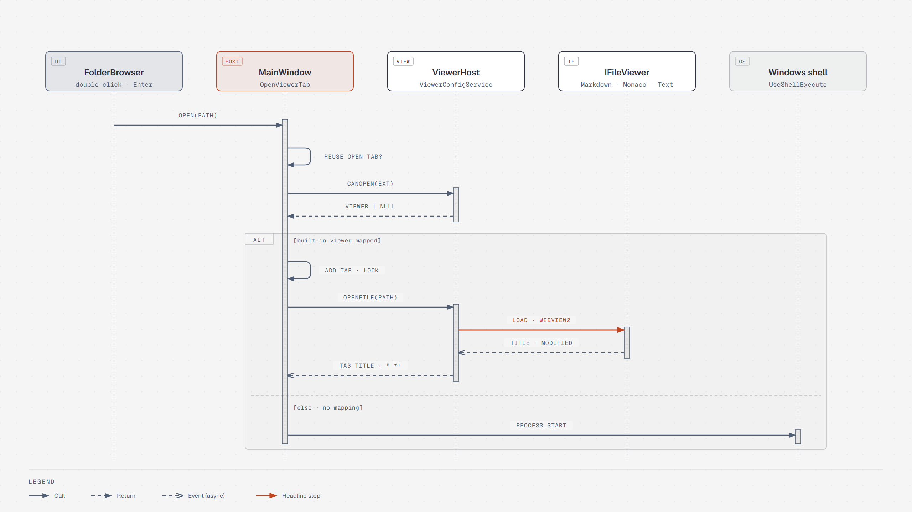
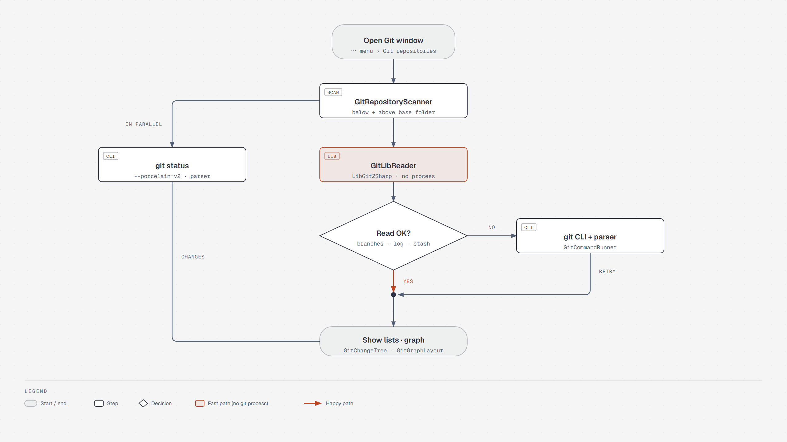
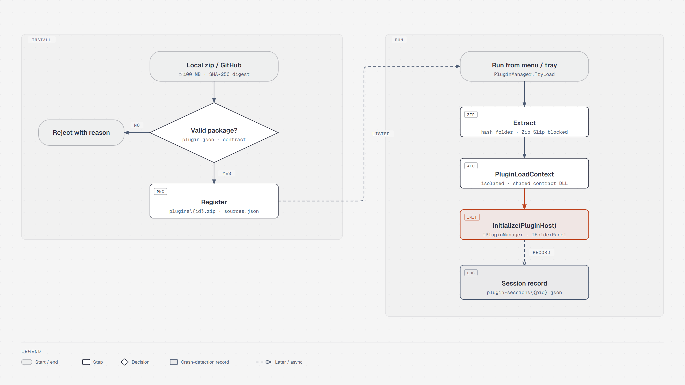
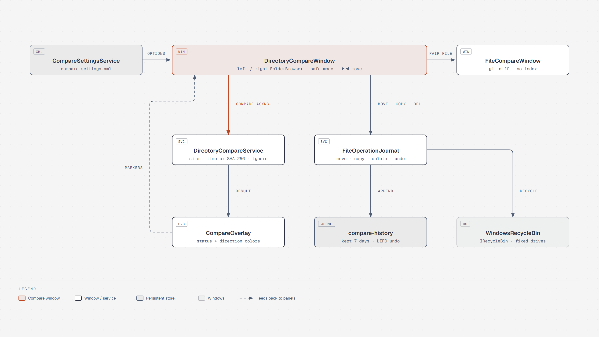

# Folderss 아키텍처 참조

## 디렉터리 구조

```
Folderss/
├── Controls/
│   ├── FolderBrowser.xaml/.cs      — 핵심 파일 브라우저 컨트롤 (패널 재사용 단위, 선택적 좌측 트리뷰·폴더 고정 잠금, ignore 필터, 검색 결과 필터, 링크 표시 포함)
│   ├── FolderBrowser.Archive.cs    — 같은 컨트롤의 zip 안 보기(읽기 전용): 가상 경로 이동·목록·zip 띠·미리보기·열기(임시 사본)·끌어 놓기·Ctrl+C·우클릭·압축 풀기/압축
│   ├── FolderBrowser.ViewerMenu.cs — 같은 컨트롤의 우클릭 "뷰어 설정 (.확장자) ▸" 하위 메뉴(partial): 선택 파일 확장자에 내장 뷰어 연결·기본값 되돌리기·설정 창 열기(`ViewerConfigService.SetMapping`/`ResetMapping`, 호스트가 `ViewerConfig` 주입)
│   ├── FolderBrowser.PathCopy.cs   — 같은 컨트롤의 경로 복사 부분(partial): 대상 고르기(선택·목록 순서, 없으면 현재 폴더), 우클릭·⋯ 메뉴 "경로 복사 ▸", 단축키, 상태 줄 잠깐 표시
│   ├── FavoritesPanel.xaml/.cs     — 즐겨찾기 패널
│   ├── GitGraphCell.cs             — 로그 한 행의 브랜치 그래프 OnRender (레인 팔레트, 병합은 빈 점, 최대 24레인)
│   ├── GitDiffView.xaml/.cs        — Git 창·파일 비교 창의 읽기 전용 diff 뷰 (줄 번호·추가/삭제 색, 늦게 온 결과 무시, Ctrl+C 복사)
│   ├── ComparePairHeader.cs        — 두 파일 비교 창 머리글 "왼쪽 | ⇄ 좌우 바꾸기 | 오른쪽" (이름·위치, 선택적 … 경로 고르기 버튼)
│   ├── SearchPanel.xaml/.cs        — 파일 검색 패널 (대상 폴더 표시·선택, 파일명/내용 대상 체크(동시 가능), 와일드카드 패턴, 내용 컬럼 표시 토글, 대/소문자·정규식·범위 옵션)
│   ├── ConsolePanel.xaml/.cs       — ConPTY 기반 내장 터미널 패널
│   ├── DiskUsagePanel.xaml/.cs     — 드라이브별 디스크 사용량 패널 (가로바, GB 단위 총량/사용량/여유)
│   ├── DiskUsageMiniPanel.xaml/.cs — 즐겨찾기 열 상단 도킹용 컴팩트 디스크 사용량 뷰 (얇은 바, 남은 용량, 툴팁 상세)
│   ├── BlockEditor.cs              — Notion 스타일 블록 편집기 컨트롤: 키 처리·블록 연산·/ 메뉴·블록 선택·끌어 옮기기·변경분 실행 취소 (partial)
│   ├── BlockEditor.Panel.cs        — 가상화 패널(IScrollInfo): 보이는 블록만 행 생성, 높이 추정·기억, 블록 기준 스크롤 앵커, 행 재사용
│   ├── BlockEditor.Row.cs          — 블록 행: 평소 TextBlock으로 그리고 편집할 때만 TextBox(입력기 등록 회피), 표 셀·이미지
│   ├── BlockEditor.Table.cs        — 표 셀 키(Tab·Enter 행 추가)·행/열 추가·삭제·엑셀 붙여넣기, /표·/이미지, 이미지 경로 해석
│   ├── BlockImageLoader.cs         — 로컬·원격(http/https) 이미지 비동기 디코딩(화면 폭으로 줄임)·LRU 캐시·원본 크기 기억, 북마크 메타데이터 조회
│   ├── BlockEditor.Media.cs        — 클립보드 이미지·복사한 파일 붙여넣기(`images/` 저장), 탐색기/폴더 패널 파일 드롭, 파일/북마크/페이지 블록 추가 대화상자(`BlockPageDialog`), 페이지 열기·만들기, 원본 크기 보기 창(`BlockImagePreviewWindow`), 순수 C# 수식 렌더러(`BlockMathRenderer`)
│   ├── BlockEditor.Color.cs        — 블록 글자색·배경색(사이드카 속성), 테마 밝기별 팔레트, 블록 메뉴 "색", 줄 안 글자 색·형광펜 리소스(테마 따라 바꿈)
│   ├── BlockEditor.Find.cs         — 찾기·바꾸기 막대(Ctrl+F/H, F3), 제목 앵커 이동, 다시 읽은 뒤 스크롤 앵커 복원, 링크 Ctrl+클릭(#75)
│   ├── BlockEditor.ViewSwitch.cs   — 블록 편집 ↔ 미리보기 전환 때 화면 맨 위 블록 → 제목·줄 번호 잡기, 받은 위치로 스크롤(#81)
│   ├── BlockEditor.FrontMatter.cs  — front matter 속성 표(키 | 값) 표시·칸 편집·속성 추가/삭제·원문 편집 전환(#81)
│   ├── BlockEditor.Inline.cs       — 줄 안 서식(#76): 서식 입력란 하나 옮겨 붙이기, Ctrl+B/I/E/Shift+S/U·링크 팝업(Ctrl+K)·서식 도구막대(밑줄·글자 색·배경색 포함)·입력 중 서식 단축·HTML/RTF 붙여넣기, 줄 안 범위의 나누기·합치기·복사·붙여넣기
│   ├── BlockInlineRenderer.cs      — 줄 안 서식 조각 ↔ WPF Inline(표시용 TextBlock·편집용 RichTextBox), 표시 글자 위치 → 편집 커서
│   ├── BlockTextInput.cs           — 블록 입력란 공통 모양 IBlockInput, 원문 입력란 BlockTextBox, 서식 입력란 RichBlockBox(보이는 글자 기준 위치·줄 API)
│   ├── ElementTree.cs              — 입력 이벤트 `OriginalSource`에서 조상 찾기(`Run` 등 ContentElement는 논리 부모로 건너감 — `VisualTreeHelper.GetParent` 예외 방지)
│   ├── ViewerHost.xaml/.cs         — 파일 뷰어 컨테이너 (IFileViewer 래퍼)
│   └── ViewerHost.ViewSwitch.cs    — `.md` 탭 툴바 `블록 편집`/`미리보기` 전환(저장 확인·위치 유지·파일별 기억, #81)
├── Viewers/
│   ├── MarkdownViewer.xaml/.cs     — Markdown 미리보기·편집·내보내기 + 활성 탭 중심 파일 변경 감시
│   ├── MonacoViewer.xaml/.cs       — Monaco 기반 코드/텍스트 편집기 (강제 언어만 넘기고 언어 결정은 편집기 안, #82)
│   ├── MonacoLanguagePicker.xaml/.cs — Monaco 탭 툴바 언어 선택(찾기 칸 + 목록, `자동`/파일별 기억, #82)
│   ├── IViewerToolbarProvider.cs   — 뷰어 전용 탭 툴바 요소를 `ViewerHost`의 `ViewerToolbarSlot`에 넣는 인터페이스
│   ├── TextViewer.xaml/.cs         — 일반 텍스트 편집기(`builtin:text`, AvalonEdit). 백그라운드 읽기·인코딩 감지, 저장(인코딩·BOM·줄 끝 유지), 상태 표시줄(인코딩▾·CRLF/LF▾·확대)
│   ├── TextViewer.Find.cs          — 찾기/바꾸기(입력하는 대로 찾기, 모든 결과 강조, 모두 바꾸기 = Ctrl+Z 한 번), 줄 이동(Ctrl+G)
│   ├── TextViewer.External.cs      — 외부 변경 감시(SHA-256 비교, 자기 저장 무시, 위치 유지)
│   ├── TextEditorRendering.cs      — 어두운 테마용 구문 색 밝게(`ThemedHighlightingColorizer`), 찾기 결과 강조(`SearchResultRenderer`)
│   ├── BlockEditorViewer.cs        — Markdown 파일을 BlockEditor로 편집하는 뷰어 (`builtin:blocks`, 인코딩·줄바꿈 유지 저장, 이미지 기준 폴더)
│   ├── BlockEditorViewer.External.cs — 블록 편집기 외부 변경 감시·반영(문서+사이드카, 자기 저장 무시, 앵커 유지), 링크 열기(#75)
│   ├── BlockEditorViewer.ViewSwitch.cs / MarkdownViewer.ViewSwitch.cs — `IMarkdownViewSwitchable` 구현(전환 전 저장, 위치 잡기·되돌리기, #81)
│   ├── IMarkdownViewSwitchable.cs  — 블록 편집 ↔ 미리보기 전환 가능한 뷰어 인터페이스(#81)
│   ├── ViewerTheme.cs              — 웹 뷰어(마크다운·텍스트)에 넘길 테마 색(JSON)·WebView 바탕색을 테마 XAML 색에서 만듦
│   └── IFileViewer.cs              — 뷰어 인터페이스 + ViewerCapabilities/ExportFormat enum
├── Models/
│   ├── FileSystemItem.cs           — 파일·폴더 뷰모델
│   ├── GitModels.cs                — Git 저장소·상태 항목·커밋·브랜치 모델
│   ├── DirectoryCompareModels.cs   — 폴더 비교 상태(CompareStatus)·옵션(DirectoryCompareOptions, 기본값 = 권장값)·항목·결과
│   ├── FavoriteLocation.cs         — 즐겨찾기 그룹·항목 모델, 그룹 위쪽 고정 바로가기(FavoritesConfiguration.Pinned) 포함
│   ├── DriveUsageInfo.cs           — 드라이브 총량·사용량·여유 공간(GB, 비율) 모델
│   ├── EditorBlock.cs              — 블록 편집기 블록(BlockKind·본문·Indent·체크·접힘·언어·콜아웃 종류, 행 재사용용 Id)
│   ├── SearchResult.cs             — 파일 검색 결과 모델
│   └── SearchTarget.cs             — 검색 대상 [Flags] enum (Content/FileName, 동시 가능)
├── Services/
│   ├── FileOperationService.cs     — 복사·이동·삭제·이름변경·새 폴더
│   ├── FilePreviewService.cs       — 텍스트·이미지 미리보기 + 메타데이터 (`GetLinkTarget`로 링크 대상 판별)
│   ├── GitRepositoryScanner.cs     — 기준 폴더 아래(와 위) Git 저장소 탐색 (순수 System.IO)
│   ├── GitCommandRunner.cs         — git CLI 실행 (ArgumentList, 타임아웃·취소·프로세스 트리 종료, UTF-8, 동시 4개)
│   ├── GitOutputParser.cs          — status porcelain v2 / log / for-each-ref / unified diff 파서
│   ├── GitLibReader.cs             — 조회(status·브랜치·로그·커밋/브랜치 비교 파일 목록·upstream 비교·stash·워킹트리)를 LibGit2Sharp로, 결과는 CLI+파서와 동일
│   ├── GitLibDiff.cs               — diff(작업 트리·스테이지·커밋·원격 비교·두 파일)를 libgit2 xdiff로 프로세스 없이, 출력 텍스트는 CLI와 동일
│   ├── GitStashCommands.cs         — stash list/push(-u, --keep-index, pathspec stdin)/apply·pop·branch(--index)/drop/clear 인수
│   ├── GitSyncCommands.cs          — pull/push/fetch/커밋/브랜치 삭제(로컬·원격)·브랜치 업데이트(base ← compare) 옵션 클래스와 인수(버튼 기본값과 ▾ 대화상자가 같은 함수 사용)
│   ├── GitRefCommands.cs           — reset(soft/mixed/hard)·브랜치 생성·detached 체크아웃·worktree add/list/remove/prune 인수
│   ├── GitConfigCommands.cs        — 저장소 설정(git config --global/--local) list -z 파서·set/unset 인수·편집 diff, 인증·작성자 키 목록 (순수 로직)
│   ├── GitRestoreCommands.cs       — 파일 되돌리기(restore --worktree / --source=HEAD --staged --worktree) 인수와 모드별 제외 규칙, Delete 키 삭제 대상(`DeletableFiles`)
│   ├── GitWindowStateService.cs    — Git 창 보기 상태(트리 보기·목록 너비·변경됨/스테이지됨 비율·브랜치 탭 원격 포함) git-window.xml 저장
│   ├── GitChangeTree.cs            — 변경 파일(평면)을 폴더 트리로 묶기, 한 자식 폴더 체인 합침 (순수 로직)
│   ├── GitGraphLayout.cs           — 부모 해시로 브랜치 그래프 레인·선분 계산 (순수 로직)
│   ├── GitBranchGraph.cs           — 브랜치 탭 요약 그래프: 브랜치 끝·HEAD·merge-base만 남기고 부모 다시 잇기, HEAD 대비 앞섬/뒤처짐 (순수 로직)
│   ├── GitEncodingDiff.cs          — UTF-16/32(BOM) "Binary files" 구간을 BOM 디코딩 + diff --no-index로 텍스트 diff로 교체
│   ├── GitDiffCommands.cs          — diff·upstream 비교·두 파일 비교(`Files`, `--no-index`) 명령 인수 (UI·테스트 공용)
│   ├── GitSettingsService.cs       — Git 설정 저장 (git-settings.xml: git 경로·pull·탐색·로그)
│   ├── DirectoryCompareService.cs  — 두 폴더 비교(상대 경로 짝짓기, 크기·시각(시각만 다르면 바이트 비교 선택) 또는 SHA-256, ignore 규칙, 폴더 집계, 취소 시 부분 결과)와 항목 복사 (순수 System.IO)
│   ├── CompareSettingsService.cs   — 폴더 비교 옵션 저장 (compare-settings.xml)
│   ├── CompareOverlay.cs           — 비교 결과를 폴더 패널 한쪽의 현재 폴더 항목에 입히는 규칙(이쪽만/저쪽만, 방향) (순수 계산)
│   ├── FileOperationJournal.cs     — 폴더 비교 창의 이동·복사·삭제 실행+기록(%LOCALAPPDATA%\Folderss\compare-history\*.jsonl, 7일 보관)과 최근부터 되돌리기. 휴지통은 IRecycleBin 주입. 외부 실행기용 기록 API(Begin/AddItem/End)·이름 변경·새 폴더·새 파일 종류·막힌 항목은 두고 나머지만 되돌리기(UndoAvailable)는 메인 패널 대기열이 씀
│   ├── FileJobs.cs                 — 메인 패널 파일 작업 모델(FileJob: 종류·상태·진행 수치·일시정지·취소), 충돌 선택(ConflictPolicy), 속도·남은 시간(TransferRate), 표시 문구 (순수 로직)
│   ├── FileJobQueue.cs             — 메인 패널 파일 작업 대기열(STA 작업 스레드 하나, FIFO): 복사·이동·삭제 실행, 이름 충돌, 이력(file-history\*.jsonl) 기록, 실행 취소 계획·실행, 이름 변경·새 폴더·새 파일 즉시 실행+기록 (순수 로직)
│   ├── FileCopier.cs               — 파일 하나 복사(Windows CopyFileEx: 진행 콜백·일시정지·취소·\\?\ 긴 경로, 대상 있으면 실패), 읽기 전용까지 지우는 삭제
│   ├── WindowsRecycleBin.cs        — IRecycleBin Windows 구현: 셸로 휴지통에 보내고, $I 정보 파일(원래 경로·삭제 시각)로 찾아 $R 항목을 되살림. 고정 드라이브만(CanSend/IsRecyclable: 고정 드라이브·260자 미만)
│   ├── CaptureSettingsService.cs   — 화면 캡쳐 설정 저장 (capture-settings.xml: 기본 저장 폴더, 기본값 사진 폴더(없으면 사용자 폴더), 설정 창 입력 검증 `Validate`)
│   ├── DiffSettingsService.cs      — 비교(diff) 설정 저장 (diff-settings.xml: 보기·공백·인코딩·외부 도구 + 프리셋, 옛 git-settings.xml 값 이관)
│   ├── DiffHtmlReport.cs           — diff 텍스트 → HTML 보고서 한 장 (양옆/한 줄, 스타일 내장·스크립트 없음, 순수 로직)
│   ├── IgnoreRuleSet.cs            — .gitignore/.folderssignore 규칙 매처 (gitignore 문법 부분집합, 폴더 목록 ignore 필터)
│   ├── SearchService.cs            — 파일 검색 (내용/파일명 대상·동시 검색, 와일드카드 패턴, 대/소문자, 정규식, 접근 거부·순환 링크 내성 순회)
│   ├── DockLayoutService.cs        — AvalonDock 레이아웃 저장·복원
│   ├── SessionStateService.cs      — 열린 폴더 경로 세션 저장·복원
│   ├── PanelLockService.cs         — 문서 탭(패널) 닫기 잠금 상태 저장·복원
│   ├── FavoritesService.cs         — 즐겨찾기 목록 저장·복원
│   ├── DiskUsageService.cs         — `DriveInfo.GetDrives()` 기반 준비된 드라이브 사용량 조회
│   ├── KeybindingManager.cs        — 단축키 매핑 및 커스터마이징
│   ├── ViewerConfigService.cs      — 확장자 ↔ 뷰어 매핑 (viewer-config.json 저장)
│   ├── MonacoLanguages.cs          — Monaco 언어: 번들 등록 정적 표·예외 사전·우선순위(`MonacoLanguages`), 사용자 연결·파일별 언어(`MonacoLanguageSettings`, `monaco-language.json`, #82)
│   ├── BlockMarkdown.cs            — 블록 목록 ↔ Markdown 변환(CommonMark 목록 중첩, <details> 토글, > [!NOTE] 콜아웃, 원문 보존), 입력 단축 판별 (순수 로직)
│   ├── BlockMarkdown.Source.cs     — 최소 변경 저장 `MarkdownSource`: 읽을 때 블록별 원문 줄 범위·형식을 기억, 저장 때 바뀐 블록만 정규형으로 다시 씀 (순수 로직, #81)
│   ├── BlockOperations.cs          — 블록 구조 연산: 하위 트리, 들여쓰기 규칙·정규화, 형제 단위 이동, 번호 표시, 접힘, 여러 열 정리·만들기·옮기기(`ColumnLayout`) (순수 로직)
│   ├── BlockSidecar.cs             — Markdown 밖 블록 속성을 문서 옆 `문서.md.meta.json`에 저장·다시 붙이기(#78, 순수 로직)
│   ├── BlockSidecarFiles.cs        — 파일 작업에서 문서와 사이드카 짝짓기(동반 파일 찾기·중복 제거·대상 이름, #78, 순수 로직)
│   ├── BlockFind.cs                — 블록 편집기 찾기·바꾸기 매칭, 제목 슬러그·앵커, 다시 읽은 뒤 스크롤 앵커 대응, 링크 해석(#75, 순수 로직)
│   ├── MarkdownViewSwitch.cs       — `.md` 블록 편집 ↔ 미리보기: 열 뷰어 고르기, 블록 ↔ 제목·줄 번호 대응, 파일별 마지막 보기·기본 보기(`markdown-view.json`, #81)
│   ├── FrontMatter.cs              — 블록 편집기 front matter 속성 표 해석·속성 줄 단위 편집(YAML 라이브러리 없음, #81, 순수 로직)
│   ├── InlineMarkdown.cs           — 줄 안 Markdown ↔ 조각 목록(굵게·기울임·취소선·코드·링크, 원문·수식 보존), 보이는 글자 기준 편집 연산·입력 단축(#76, 순수 로직)
│   ├── ClipboardMarkdown.cs        — 붙여넣기 HTML → Markdown(줄 안 서식·문단·제목·목록) + 줄마다 밑줄·글자 색·형광펜 범위(#76, 순수 로직)
│   ├── TextMarks.cs                — 줄 안 밑줄·글자 색·형광펜 범위(사이드카 `marks`): 값 형식·보이는 글자 해시 검증, 본문 변경에 따른 범위 이동·나누기·합치기, 조각 ↔ 범위(#76 9번, 순수 로직)
│   ├── OpenWithService.cs          — 확장자 마스크 기반 외부 열기 프로그램 저장·실행
│   ├── ConsoleSettingsService.cs   — 콘솔 기본 프로필/사용자 정의 프로필 설정 저장
│   ├── ConsoleSessionService.cs    — 기본 셸 탐색, 프로필 해석, 외부 터미널 실행 관리
│   ├── ShellContextMenuService.cs  — Windows 쉘 우클릭 컨텍스트 메뉴 (맨 위 앱 항목 `CustomMenuItem`: `Label` null = 구분선, `Children` = 하위 메뉴)
│   ├── PathCopyFormatter.cs        — 경로 복사 형식(전체·따옴표·이름·상위 폴더·저장소/반대편 패널 기준 상대·UNC), 구분자, 대체 규칙, Windows 경로 루트·상대 경로 계산 (순수 로직, OS와 무관하게 같은 결과)
│   ├── PathCopyService.cs          — 경로 복사의 Windows 쪽: 저장소 찾기(.git 폴더/파일), UNC 변환(WNetGetUniversalName → WNetGetConnection), 텍스트만 클립보드, 셸·WPF 메뉴 항목 만들기, 단축키 표시
│   ├── PathCopySettingsService.cs  — 경로 복사 설정 저장 (path-copy-settings.xml: 단축키 형식·경로 구분자, `Current`, SettingsFile 사용·실패는 예외)
│   ├── PluginManager.cs            — 플러그인 로드(플러그인별 AssemblyLoadContext, 계약 DLL은 본체 것 공유)·팝업 창·IPluginManager 구현(PluginHost)·팝업용 폴더 패널·플러그인 예외 판별
│   ├── PluginPackage.cs            — plugin.json 검증, 진입점 DLL의 계약 참조 버전 확인, plugins\<id>.zip 등록·목록, 해시별 폴더로 안전한 압축 해제 (순수 로직)
│   ├── ZipArchiveService.cs        — zip 가상 경로(`ZipArchivePath`: `C:\a\b.zip\sub` 분해·결합), 목록 트리(`ZipListing`)·캐시(`ZipListingCache`), 풀기 계획·실행(Zip Slip 이중 검사·이름 정리·충돌 모드·취소), zip 만들기 (순수 로직)
│   ├── ZipEntryNameEncoding.cs     — UTF-8 플래그 없는 zip 이름을 항목마다 ASCII→UTF-8→CP949→CP437 순으로 판정하는 읽기 전용 Encoding (순수 로직)
│   ├── ZipTempStore.cs             — zip 안 파일 열기·클립보드 복사용 실행별 임시 폴더(%TEMP%\Folderss\zip\<pid>-<시각>), 종료 때 정리·하루 지난 폴더 수거 (순수 로직)
│   ├── PluginGitHubSource.cs       — 공개 GitHub 저장소 최신 정식 릴리스 조회·zip 받기(100MB 제한, digest SHA-256 비교), 오류는 문장 예외 (순수 로직)
│   ├── PluginSourceStore.cs        — plugins\sources.json: 플러그인 id별 설치 출처(local / github.com/<소유자>/<저장소>) (순수 로직)
│   ├── PluginDisplayStore.cs       — plugins\display.json: 플러그인 id별 표시 방식(popup / main). 기록 없음·깨진 파일 = 팝업 (순수 로직)
│   ├── PluginSettingsStore.cs      — 플러그인별 키/값 settings.json (SettingsFile 사용, 실패는 예외)
│   ├── PluginAppSettings.cs        — 플러그인에 주는 본체 설정 읽기 전용 키 목록 (명시 매핑, 순수 로직)
│   ├── PluginSessionRecord.cs      — PluginSessionLog: plugin-sessions\<pid>.json 기록·주인 없는 기록 수거·plugin-log.txt (순수 로직)
│   ├── SettingsFile.cs             — 설정 파일 원자적 쓰기 헬퍼 (임시 파일 → File.Move 교체, 실패는 예외)
│   ├── ClipboardService.cs         — 클립보드 읽기·쓰기. 다른 프로그램이 점유 중(CLIPBRD_E_CANT_OPEN)이면 경고 후 false (앱 종료 방지)
│   ├── CaptureAnnotation.cs        — 캡쳐 편집 도형·캡쳐 이미지 자리 하나(불변 값): 이동·자르기/크기 조절 변환(굵기·글자는 기하 평균 배율), 정리, 선택 판정(상자형은 테두리 상자 안, 화살표는 선 거리), 핸들 목록·판정·끌기(이미지 모서리는 비율 유지), 맨 위 도형 찾기 (순수 로직)
│   ├── ScreenCaptureService.cs     — 화면 캡쳐 순수 계산: 오버레이 좌표 → 이미지 픽셀 사각형(비율 변환), 빠른 저장 파일 이름, 확장자 → 저장 형식, 화살표 머리 좌표, 크기 조절 비율 유지 (순수 로직)
│   ├── ThemeFileValidator.cs       — 실행 폴더 Themes\ XAML 검사(허용 요소·태그 확장만, 순수 로직)
│   └── ThemeManager.cs             — 시작 시 테마 자동 인식(기본 + 실행 폴더 Themes\, ThemeInfo), 전환 및 저장
├── Converters/
│   └── FractionToStarConverter.cs  — 0~1 비율 → Star `GridLength` 변환 (디스크 사용량 가로바)
├── Themes/
│   ├── Black.xaml                  — 블랙 테마 색상 팔레트
│   ├── Light.xaml                  — 라이트 테마 색상 팔레트
│   ├── Nord.xaml                   — Nord 테마
│   ├── Catppuccin.xaml             — Catppuccin Mocha 테마
│   ├── Solarized.xaml              — Solarized Dark 테마
│   ├── Dracula.xaml                — Dracula 테마
│   ├── GitHub.xaml                 — GitHub (Primer Light) 테마
│   ├── Sakura.xaml                 — Sakura 테마 (핑크, 밝은 테마)
│   ├── Sunset.xaml                 — Sunset 테마 (오렌지, 어두운 테마)
│   ├── Peach.xaml                  — Peach 테마 (밝은 오렌지, 밝은 테마)
│   ├── TokyoNight.xaml             — Tokyo Night 테마
│   ├── OneDark.xaml                — One Dark 테마
│   ├── Monokai.xaml                — Monokai 테마
│   ├── Gruvbox.xaml                — Gruvbox Dark 테마
│   └── Controls.xaml               — 공통 컨트롤 스타일 (모든 테마 공유)
├── MainWindow.xaml/.cs             — 메인 창, AvalonDock 호스트, 전역 단축키
├── MainWindow.FileJobs.cs          — (partial) 파일 작업 대기열 연결: 복사·이동·삭제 넣기, 이름 충돌 질문, 끝나면 새로 고침·실패 요약, 실행 취소(Ctrl+Z) 확인, 종료 시 진행 중 작업 확인
├── FileJobsWindow.cs               — 파일 작업 진행률 창(비모달, 대기열 전체·일시정지·취소)과 이름 충돌 대화상자 `FileConflictDialog`(GitDialogBase 상속), 코드로 구성
├── GitDialogs.cs                   — Git 선택 대화상자(GitDialogBase + reset·브랜치·체크아웃·워킹트리·브랜치 업데이트·원격 브랜치 삭제·저장소 설정), 코드로 구성
├── GitWindow.xaml/.cs              — 다중 저장소 Git 창 (비모달, ⋯ 메뉴 > Git 저장소…)
├── FileCompareWindow.cs            — 폴더 패널에서 고른 두 파일 비교 창 (비모달, ComparePairHeader, 좌우 바꾸기, GitDiffView + `GitLibDiff`, 안 되면 `git diff --no-index`), 코드로 구성
├── DirectoryCompareWindow.cs       — 폴더 비교 창 (비모달, 좌우 FolderBrowser 안전 모드 + 가운데 분할선·▶◀ 이동 + 작업 이력 패널). 같은 파일에 `CompareConfirmDialog`·`DirectoryCompareOptionsDialog`(GitDialogBase 상속), 코드로 구성
├── DiffToolLauncher.cs             — 외부 비교 도구 실행 공용(사전 검사·안내 + `git difftool`), Git 창·두 파일 비교 창이 사용
├── ArchiveDialogs.cs               — `ArchiveExtractDialog`·`ArchiveCompressDialog`(GitDialogBase 상속), `ArchiveProgressWindow`(0.4초 넘는 작업만, 취소), `ArchiveOperations`(백그라운드 실행·오류 알림·zip 이름 폴더 풀기)
├── MainWindow.Perspectives.cs      — (partial) 퍼스펙티브: 메인 창을 파일 화면(DockManager)과 메인 창에 띄운 플러그인 화면 사이에서 전환, 제목 표시줄 전환 버튼, Ctrl+F8, 플러그인 예외 시 떼어 내기
├── MainWindow.Archive.cs           — MainWindow의 zip 연결: 파일 작업 가드(`BlockedInArchive`), 이동·복사 처리, 반대편 패널, 결과 선택, ⋯ 메뉴 `압축 풀기…`·`zip으로 압축…`
├── DiffReportDialog.cs             — HTML 보고서 형식 선택 대화상자 + 저장 흐름(`DiffReportExporter`)
├── SettingsWindow.xaml/.cs         — 설정 창 (테마, 단축키, 뷰어, 열기 프로그램, 콘솔, Git, 비교, 캡쳐, 네트워크, 경로 복사, 플러그인)
├── KeyCaptureWindow.cs             — 단축키 입력 캡처 팝업
├── CaptureOverlayWindow.cs         — 화면 캡쳐: 가상 화면 전체를 GDI로 찍고(`CaptureVirtualScreen`) 모든 모니터를 덮는 창에 깔아 드래그로 영역 선택, 코드로 구성
├── CaptureResultWindow.cs          — 화면 캡쳐 결과 팝업(비모달): 편집 도구 줄, 클립보드 복사, 활성 폴더에 빠른 저장, ▾ 메뉴(다른 이름으로 저장, 기본 저장 폴더 탐색기로 열기), 저장 후 탐색기 열기 확인 (`SettingsFile.Write`로 임시 파일 후 교체), 편집 후 미저장 닫기 확인. 같은 파일에 `CaptureResizeDialog`(GitDialogBase 상속)
├── CaptureEditor.cs                — 캡쳐 편집면: 흰 페이지 위에 캡쳐 이미지(배열 [0], `Kind == Image`, 비트맵은 하나로 고정)와 도형. 상태 = (페이지 크기, 불변 `CaptureAnnotation` 배열). 화면 요소는 배열에서 매번 다시 만들고 저장·복사 때만 `Render`(RenderTargetBitmap)로 합침(바꾼 것이 없으면 캡쳐 원본 그대로). 내보내는 층과 미리보기·선택 표시·텍스트 입력 층 분리. 선택(이미지·도형 이동·핸들, 도형 Delete), 자르기·크기 조절은 페이지 크기만 바꾸고 이미지·도형은 좌표 변환. `ExpandPageToDisplay`(처음 열 때 모니터 해상도만큼 흰 배경), `ResizePage`(배경만 변경). 상태 스냅숏 되돌리기. 좌표는 페이지 픽셀, 표시는 LayoutTransform으로 1:1
├── AboutWindow.cs                  — 정보 창
├── PromptWindow.cs                 — 이름 변경·새 폴더 입력 다이얼로그
├── App.xaml/.cs                    — 앱 진입점, 테마 초기 로드, 플러그인 발 UI 예외 처리
└── docs/
    ├── architecture.md             — 코드 구조와 확장 포인트 참조
    ├── PROJECT.md                  — 로컬 개발 아이템 운용 규칙
    ├── items/                      — 현재 개발 아이템 상태와 상세 내용의 단일 기준
    └── done/DONE.md                — 기존 릴리스 완료 이력
```

---

## 서비스 역할 상세

### ThemeManager
- 테마 목록은 코드에 없다. 시작할 때(`App.OnStartup` → `ApplySavedTheme`가 처음 `Themes`를 읽을 때) 한 번 만든다.
  - 기본 테마: 빌드에 포함된 `themes/*.baml`(Controls 제외)을 어셈블리 리소스(`Folderss.g.resources`)에서 찾는다.
  - 외부 테마: 실행 폴더 `Themes\*.xaml`(`ExternalThemesDirectory`)을 `ThemeFileValidator`로 검사(허용 요소만, DTD 금지)한 뒤
    `XamlReader.Parse`로 읽는다. 같은 `ThemeName`이면 기본 테마를 대신한다. 실패한 파일은 `LoadErrors`에 모아 메인 창이 시작 후 한 번 알린다.
  - 각 테마는 `ThemeInfo`(이름·표시 이름·순서·`ResourceDictionary`)가 된다.
  - 이름은 테마 XAML의 `ThemeName`, 없으면 파일 이름(BAML 리소스 이름이라 소문자). 표시 이름 `ThemeDisplayName`, 순서 `ThemeOrder`(없으면 맨 뒤).
  - 읽지 못하거나 `Black.xaml`에 있는 키(테마 정보 키 제외)가 빠진 파일은 건너뛴다 — 테마 하나 때문에 앱이 시작되지 않는 일을 막음.
  - 밝은 테마 여부(`IsLight`)는 `PanelBackgroundColor` 밝기로 판단한다.
- 메인 메뉴 `테마`(`BuildThemeMenu`)와 설정 창 테마 탭(`BuildThemeList`)은 이 목록으로 코드에서 만든다.
- 웹 뷰어 색은 `Viewers/ViewerTheme`가 테마 색에서 만들어 `app.open`/`app.setTheme`에 `{ light, colors }`로 넘기고, 페이지는 `body.themed`의 CSS 변수로 쓴다.
  Monaco는 편집기 테마가 light/dark 두 가지라 `IsLight`만 쓴다.
- 선택한 테마의 `ResourceDictionary`를 `App.Resources.MergedDictionaries`에서 교체하는 방식으로 런타임 전환
- `%LOCALAPPDATA%\Folderss\theme.txt`에 마지막 테마 이름 저장(읽을 때 대소문자 무시, 없는 이름이면 Black)
- 테마 파일 키 검사: `tests/Folderss.SearchTests/ThemeFileTests`(모든 테마가 `Black.xaml`과 같은 키, 이름 중복 없음, 기본 테마가 외부 검사도 통과, 위험 요소 거부)

### MarkdownViewer 이미지 리소스 해석
- 미리보기 HTML은 `https://folderss-viewer/markdown-app.html`(가상 호스트 → `Viewers/Resources`)에서 로드되므로,
  마크다운 본문의 상대 경로 이미지(``, `` 등)를 그대로 두면
  현재 파일 기준이 아니라 `Resources` 폴더 기준으로 요청되어 항상 깨진다.
- `marked.use({ renderer: { image ... } })`로 스킴이 없는 이미지 href를 `https://folderss-doc-asset/resolve?p=<encodeURIComponent(href)>`로 치환한다 (`http(s):`, `data:`, `file:`, `ftp:`, `mailto:`만 원본 유지).
- `MarkdownViewer.OnWebResourceRequested`가 `folderss-doc-asset` 호스트 요청을 가로채, 쿼리의 원본 경로 문자열을
  `ResolveLocalLinkPath`(파일 내 링크 클릭과 동일한 해석 로직)에 그대로 넘겨 현재 열려 있는 `.md` 파일 기준
  절대 경로로 해석한 뒤 `File.ReadAllBytes`로 읽어 응답한다.
- 쿼리 문자열에 원본 경로를 담아 브라우저의 URL 정규화(가상 호스트 폴더 매핑은 상위 폴더로 못 올라감)를 우회하므로
  `../`로 상위 폴더의 이미지를 참조해도 정상 동작한다.
- CSP `img-src`에 `folderss-doc-asset`과 `data:`, `http(s):`을 추가해 로컬 리졸브 이미지·데이터 URI·원격 이미지를 모두 허용한다.
- "HTML로 내보내기"(`exportHtml`)로 저장한 독립 HTML 파일은 앱 밖에서 열리므로 `folderss-doc-asset` 주소가 동작하지 않는다.
  그래서 `MarkdownViewer.InlineDocAssets`가 저장 직전에 이 주소들을 같은 경로 해석으로 읽은 data URI로 바꾼다
  (미리보기·인쇄/PDF 내보내기는 같은 WebView2 세션 안에서 렌더링되므로 바꿀 필요 없음).

### MarkdownViewer 본문 HTML 정화와 링크 실행 확인
- marked는 본문의 HTML을 그대로 통과시키고 페이지 CSP가 인라인 스크립트를 허용하므로, `renderPreview`가
  `marked.parse` 결과를 `DOMPurify.sanitize`(`Resources/purify.min.js`)로 거른 뒤 `innerHTML`에 넣는다.
  걸러내지 않으면 문서 안 스크립트가 `chrome.webview.postMessage`로 파일 저장(`save-request`)이나 로컬 파일 실행(`open-link`)을 요청할 수 있다.
- URI 허용 목록(`SANITIZE_OPTIONS.ALLOWED_URI_REGEXP`)은 DOMPurify 기본값에 `file:`와 Windows 드라이브 경로(`C:\`, `C:/`, marked가 인코딩한 `C:%5C`)를 더했다.
- Mermaid·KaTeX·highlight.js는 정화된 DOM 위에서 동작하므로 영향이 없다.
- `HandleLinkClick`은 `.md`가 아닌 로컬 파일을 열기 전에 `FileOperationService.IsExecutable`로 실행 형식을 판정하고,
  실행 형식이면 확인창(기본값 "아니요")을 띄운다.

### MarkdownViewer 렌더링 보조 (수식·Mermaid·화면 상태)
- 수식: marked 확장(`mathBlock`, `mathInline`)이 `$…$`(Pandoc 규칙)·`$$…$$`·`\(…\)`·`\[…\]` 구간을 marked 처리 전에 떼어 `data-tex`에 담고,
  정화 뒤 `renderMath`가 `katex.render`로 그린다. KaTeX auto-render는 쓰지 않는다.
- Mermaid: "테마 + 원문"을 키로 그린 SVG를 `_mermaidCache`에 두고 바뀌지 않은 다이어그램은 다시 그리지 않는다.
- 화면 상태: 파일별 보기 모드와 공통 목차 표시·너비를 페이지 `localStorage`(`folderss.markdown.prefs`)에 저장한다.
  `app.open`의 다섯 번째 인자가 파일 경로다.

### MarkdownViewer 페이지 구조 (스크립트·CSP·요소 id)
- 페이지는 `markdown-app.html`(마크업·CSS)과 `markdown-app.js`(전체 스크립트, `app` 공개 API)로 나뉜다.
  CSP는 `script-src 'self' https://folderss-viewer`로 인라인 스크립트·`onclick` 속성을 허용하지 않으므로, 버튼 동작은 `markdown-app.js` 끝의 "Toolbar wiring"에서 연결한다.
  C#의 `ExecuteScriptAsync`는 CSP 영향을 받지 않는다.
- 소문자로만 된 앱 요소 id는 `mdv-` 접두사를 쓴다(`mdv-preview-pane`, `mdv-editor-textarea` 등). 문서 제목 앵커(항상 소문자)와 겹치지 않게 하기 위함이다.
- KaTeX 글꼴은 `Resources/fonts/`(KaTeX 0.16.9 `woff2`)에 있다.
- Mermaid·KaTeX·highlight.js는 페이지에 고정으로 넣지 않고, 렌더링한 문서에 다이어그램·수식·코드 블록이 있을 때 `loadLib`/`withLib`로 불러온다.
- WebView2 뷰어(Markdown·Monaco·Text)는 `CoreWebView2Settings.IsReputationCheckingRequired = false`로 SmartScreen 평판 검사를 끈다.
  내부 가상 호스트만 열기 때문에 검사가 보호할 대상이 없고, 검사 서버를 기다리느라 페이지 표시가 약 2초 늦어졌다(`docs/items/webview-smartscreen-load-delay.md`).
- WebView2 뷰어 공통 동작:
  - `ApplyTheme`이 `WebView.DefaultBackgroundColor`를 페이지 테마 배경과 같은 색으로 지정하고, 페이지는 테마를 받기 전 배경을 투명하게 둬 로딩 중 깜빡임을 없앤다.
  - `Viewers/WebViewIdleSaver`가 뷰어가 화면에서 가려지면 메모리 목표를 `Low`로, 30초 넘게 가려지면 `TrySuspendAsync`로 일시 중지하고, 다시 보이면 재개한다.
    가려진 탭에 오는 테마 변경·제목 이동은 미뤘다가 다시 보일 때(`OnBecameVisible`) 적용한다.
  - 세 뷰어 모두 `IDisposable`로 탭을 닫을 때 `WebView.Dispose()`한다.

### MarkdownViewer 원격 이미지와 네트워크 설정 (network-settings.xml)
- 판정은 `Services/RemoteContentPolicy`(순수 로직, 단위 테스트), 설정은 `Services/NetworkSettingsService`(`Current`, 저장 시 `Changed`). 설정 창 "네트워크" 탭.
- `OnWebResourceRequested`: 이미지 요청이고 `RouteImage == Direct`(https: 표시 설정 켜짐 또는 localhost)면 WebView2가 직접 받는다. 그 밖의 외부 요청은 403.
- http 이미지: `markdown-app.js resolveImageSrc`가 `https://folderss-doc-asset/remote?u=<원래 주소>`로 바꾸고, `ProxyRemoteImage`가 `RouteImage == Proxy`
  (localhost 또는 표시+http 허용)일 때만 `HttpClient`로 받아 전달한다(`image/*`, 20MB, 15초). 뷰어 페이지가 https라 http 이미지는 혼합 콘텐츠로 막히기 때문.
- 인증서: Windows 저장소로 먼저 검증하고, 실패하면 `ServerCertificateErrorDetected`(WebView2)·`ServerCertificateCustomValidationCallback`(HttpClient)에서
  `ShouldAllowCertificateError`(localhost·오류 허용·추가한 내부 인증서로 체인+호스트 이름 확인)로 다시 판정한다. 설정 저장 시 `ClearServerCertificateErrorActionsAsync`.
- 플러그인 GitHub 설치(`PluginGitHubSource.CreateClient`)도 같은 콜백을 쓰되 `PluginGitHubSource.ShouldAllowCertificateError`로 "인증서 오류 허용"을 끈 채 판정한다(실행할 코드를 받는 경로).
- 다른 문서 제목 링크(`other.md#제목`): 링크를 누른 뷰어가 정적 `PendingAnchors[대상 전체 경로]`에 조각을 넣고 파일 열기를 요청하면,
  그 파일의 뷰어가 `CallAppOpen` 직후 또는 `SetActive(true)` 때 꺼내 `app.scrollToAnchor`를 호출한다.

### FileJobQueue / 파일 작업 진행률 창 / 메인 패널 실행 취소
- 메인 패널의 복사·이동(`F6`·⋯ 메뉴 `반대편 패널로 복사`, 붙여넣기 `TryPasteFromClipboardInto`, 끌어다 놓기 `FolderBrowser.FileList_Drop`)과 삭제(`DeleteSelected`)는
  `FileOperationService`를 직접 부르지 않고 `MainWindow.QueueFileTransfer`/`QueueFileDelete`(MainWindow.FileJobs.cs)로 `FileJobQueue`에 넣는다.
  확인 창·고정(📌) 잠금 검사는 넣기 전에 호출부가 한다. 링크 만들기·바로 가기 놓기는 그대로 동기.
- 대기열은 작업 스레드 하나(셸 휴지통 때문에 STA)에서 넣은 순서대로 하나씩 실행한다. 나란히 돌리지 않는 이유: 같은 디스크에서 서로 느려지고,
  "복사 → 원본 삭제"처럼 이어지는 작업이 순서를 잃으며, 실행 취소 이력 순서가 실행 순서와 같아진다.
- 실행: 복사·이동할 파일 수·크기를 먼저 센다(같은 드라이브 안 이동은 이름만 바뀌므로 세지 않음). 파일은 `FileCopier.CopyFile`(CopyFileEx 진행 콜백 안에서
  `FileJob.Checkpoint` — 일시정지면 기다리고 취소면 PROGRESS_CANCEL). 폴더는 직접 걸으며 파일마다 복사(링크 폴더 순환은 깊이 256에서 멈춤, 숨김·시스템 폴더 속성 보존).
  다른 드라이브 이동은 복사 후 원본 삭제. 같은 드라이브인데 장치가 다르면(ERROR_NOT_SAME_DEVICE) 복사 후 삭제로 돌린다.
- 이름 충돌은 실행 중에 `AskConflict`(작업 스레드 → `Dispatcher.Invoke` → `FileConflictDialog`)로 묻는다. 기본 건너뛰기, "나머지에도 적용"은 `ConflictPolicy`가 기억.
  바꾸기는 대상 옛 항목을 휴지통으로(복사는 임시 이름 `~folderss-*.tmp`로 다 복사한 뒤 바꿔치기 — 실패·취소 시 옛 항목 그대로). 휴지통이 없으면(`IRecycleBin.CanSend`) 바꾸지 않는다.
- 취소·실패한 최상위 항목은 원래대로 돌린다(만들던 복사본·임시본 삭제, 바꾸려고 보낸 옛 항목 복원). 폴더 복사 안의 파일 실패는 그 파일만 빼고 계속, 폴더 이동은 하나라도 실패하면 되돌림.
- 끌어다 놓기 이동은 대기열이 끝까지 처리하므로 원본 쪽에 `DragDropEffects.None`을 돌려준다(셸 "최적화 이동" 규약 — Move를 돌려주면 탐색기가 아직 복사 중인 원본을 지울 수 있다).
- 이력: `%LOCALAPPDATA%\Folderss\file-history\*.jsonl`(폴더 비교 창 `compare-history`와 분리 — 비교 창 이력 패널과 메인 창 `Ctrl+Z`가 서로의 작업을 되돌리지 않게).
  작업 시작 때 `FileOperationJournal.Begin`, 최상위 항목마다 `AddItem`, 끝에 `End`. 이력을 못 쓰면 작업은 하되 "실행 취소할 수 없음"을 알린다(비교 창은 실행 거부).
  이름 변경·새 폴더·새 파일은 UI 스레드에서 바로 실행하고 같은 이력에 기록(`Rename`/`CreateFolder`/`CreateFile`). 이력 객체 접근은 모두 `_journalLock`.
- 블록 편집기 사이드카(#78, `BlockSidecarFiles`, `docs/items/block-sidecar-file-ops.md`): `Run`이 작업 목록을 `Pair`로 (항목, 동반 `X.md.meta.json`)으로 묶고
  (문서와 사이드카를 둘 다 골랐으면 사이드카는 문서에 붙여 한 항목), 문서가 성공하면 바로 뒤에 사이드카를 문서가 간 이름(`a (2).md` → `a (2).md.meta.json`)으로 복사·이동·삭제한다.
  충돌은 따로 묻지 않고 문서 결과를 따른다(건너뜀 → 그대로, 대상 자리 사이드카는 휴지통으로 바꿈). 사이드카만 실패하면 문서는 성공, 오류 목록에 경고.
  사이드카 결과는 같은 작업 기록의 별도 `JournalItem`(`CompanionOf` = 문서 원래 경로, 기록 줄 `"of"`)이라 실행 취소 한 단계로 함께 되돌아가고, 새 `JournalOperationKind`는 없다.
  `Rename`도 사이드카 이름을 바꿔 한 작업으로 기록한다. 사이드카 안 `file` 필드는 고치지 않는다(`BlockSidecar.Apply`가 쓰지 않음). 폴더 비교 창·zip 꺼내기는 적용 안 됨.
- 실행 취소(`Ctrl+Z` = `UndoFileOperation`, ⋯ 메뉴 `실행 취소: …`): 대기열이 비어 있을 때만. 메뉴 머리글은 파일을 보지 않는 `PeekUndo`로 채운다.
  `PlanUndo`(백그라운드 — 항목이 많으면 파일·휴지통 확인이 오래 걸림)가 최근 되돌릴 작업과 항목별 막힘(`ItemProblems`: 그 사이 바뀜·원래 자리 점유·
  휴지통에 없음·휴지통 없는 위치의 복사본·내용이 생긴 새 폴더/파일)을 계산하고, 확인 창(`CompareConfirmDialog`)이 막힌 항목이 있으면 확인 체크를 요구한다.
  `WindowsRecycleBin`은 휴지통 폴더의 `$I` 목록을 폴더 수정 시각이 같으면 다시 쓰므로(항목이 들고 나면 시각이 바뀜) 항목마다 휴지통 전체를 읽지 않는다.
  실행은 대기열 작업(`FileJobKind.Undo`)으로 `UndoAvailable` — 막힌 항목은 그대로 두고 작업을 "넘김"으로 기록. 되돌릴 항목이 하나도 없으면 넘길지 묻는다.
  영구 삭제는 기록만 하고 대상에서 건너뛴다(확인 창에 그 뒤 영구 삭제 수 표시). 되돌리면 고정(📌) 폴더 구조가 바뀌는 경우는 막는다.
- 진행률 창(`FileJobsWindow`): 작업이 0.8초 넘게 걸리면 포커스를 뺏지 않고 뜨며(`ShowActivated=false`), 0.25초마다 `FileJob.Snapshot`을 그린다. 자동으로 뜬 창은 사용자가 만지지 않았으면 대기열이 비고 1.5초 뒤 닫힌다.
  끝난 작업은 30개까지 목록에 남는다. 끝나면 `OnFileJobFinished`가 모든 패널을 새로 고치고 실패·남긴 항목을 메시지 하나로 알린다(취소는 알리지 않음).
- `Delete`: 휴지통에 보낼 수 없는 항목(`WindowsRecycleBin.IsRecyclable` — 네트워크·이동식·260자 이상)이 섞이면 영구 삭제 경고 + 확인 체크 후 따로 영구 삭제 작업으로 넣는다. `Shift+Delete`도 확인 체크.
- 종료(`Window_Closing`): 대기열에 작업이 있으면 묻고, 종료하면 모두 취소한 뒤 최대 5초 메시지를 돌리며 기다린다(진행 중 항목 되돌리기).
- 테스트: `tests/Folderss.SearchTests/FileJobQueueTests.cs`(진행 수치, 충돌 선택·적용, 바꾸기와 되돌리기, 일시정지·FIFO, 대기 취소, 복사 도중 취소, 잠긴 파일, 긴 경로, 휴지통 없음,
  부분 되돌리기, 넘기기, 이름 변경·새 항목, 중단된 작업, 이력 쓰기 실패, 속도·문구), 사이드카 동반 처리는 같은 클래스의 `FileJobQueueSidecarTests.cs`. 진행률 창·대화상자는 WPF라 실제 실행으로 확인한다.

### KeyBindingService
- 기본 단축키 매핑을 코드에서 정의
- 사용자 커스터마이징을 XML로 `%LOCALAPPDATA%\Folderss\keybindings.xml`에 저장
- `kb.Matches(e, "CommandId")` 패턴으로 MainWindow PreviewKeyDown에서 사용
- **단축키 추가 시 연관 파일**: KeyBindingService.cs, MainWindow.xaml.cs, SettingsWindow

### 경로 복사 (PathCopyFormatter / PathCopyService / FolderBrowser.PathCopy)
- 진입점 세 곳이 같은 `FolderBrowser.CopyPaths`로 모인다: 파일 목록·트리뷰 셸 우클릭 메뉴 맨 위 `경로 복사 ▸`(`BuildPathCopyShellMenu`),
  ⋯ 메인 메뉴 `경로 복사`(`MainMenuButton_Click` → `ActivePane.FillPathCopyMenu`, 열 때마다 다시 채움), 단축키 `CopyFolderPath`(기본 `Ctrl+Shift+C`, `CopyPathForShortcut`).
  ID는 예전 트리 전용 "폴더 경로 복사" 그대로라 사용자 keybindings.xml이 계속 맞는다.
- 대상: 선택 항목을 목록에 보이는 순서로, 없으면 현재 폴더. 단축키는 트리에 포커스가 있으면 트리에서 고른 폴더.
- 형식 규칙은 모두 `PathCopyFormatter`(순수, `tests/.../PathCopyFormatterTests.cs`). System.IO.Path를 쓰지 않고 Windows 루트(`C:\`, `\\server\share`, `\\?\`)를 직접 처리해
  테스트가 OS와 무관하다. 조건부 형식(저장소 기준·반대편 패널 기준·UNC)은 `IsAvailable`이 참일 때만 메뉴에 보이고, 단축키 형식으로 쓸 수 없으면 그 항목만 전체 경로로 대신(`FallbackCount`).
- 저장소 루트는 항목을 **담은 폴더**부터 위로 `.git` 폴더/파일을 찾는다(저장소 루트 폴더 자신은 상위 저장소 기준). 반대편 패널은 `MainWindow.AttachFolderBrowser`가 넣는
  `OppositeFolderProvider`(이 패널이 아닌 첫 폴더 패널 — ⋯ 메뉴 "반대편 패널"과 같은 규칙). 폴더 비교 창·플러그인 팝업 패널은 넣지 않아 그 형식이 없다.
- UNC: 드라이브 종류가 네트워크일 때만 `WNetGetUniversalName`(UNIVERSAL_NAME_INFO), 안 되면 `WNetGetConnection` + 나머지 경로(`CombineUnc`). 로컬 드라이브를 관리 공유(`\\PC\C$`)로 바꾸지 않는다.
- 클립보드는 텍스트만(`ClipboardService.TrySetDataObject(string)`, FileDrop 없음), 복사 후 잘라내기 표시 해제. 상태 줄 문구(`StatusMessage`)는 셸 메뉴 뒤 `RefreshItems`가 덮지 않게 디스패처 뒤로 미뤄 4초 보인다.
- 셸 메뉴 하위 메뉴: `ShellContextMenuService.InsertCustomItem`이 `CreatePopupMenu` + `MF_POPUP`으로 붙이고, 명령 번호는 하위 메뉴 안 항목까지 순서대로 `CustomCmdBase + n`. 부모 `DestroyMenu`가 하위 메뉴도 정리한다.
- 설정(`설정 > 경로 복사`, `PathCopySettingsService.Current`): 단축키 형식, 구분자(`\` / `/` 상대 경로만 / `/` 모든 경로). 메뉴·단축키는 복사할 때마다 `Current`를 읽어 저장 즉시 반영.

### SearchPanel / SearchService
- `Ctrl+F`(`ShowSearch`)로 여는 별도 팝업 창(`파일 검색`)에서 실행, `MainWindow.ShowSearchPanel()` 참고
- 검색 창은 모달이 아니라 계속 떠 있는 도구 창이다. 대상 폴더는 `MainWindow.UpdateSearchRoot()`가
  `_searchWindow.Activated`마다 활성 패널 기준으로 갱신한다 — 창을 열 때만 갱신하면 창을 열어둔 채
  트리뷰 등으로 폴더를 옮겼을 때 옛 폴더를 계속 검색해 오류 없이 0건이 된다
- 대상 폴더 경로는 패널 상단 `RootPathBox`가 상시 표시한다. `폴더 선택…`(`BrowseRootButton`)으로 직접 고르면
  `_rootPinned`가 서고 `SetRootPath`(자동 동기화)가 무시된다 — 그러지 않으면 창이 포커스를 받을 때마다
  사용자가 고른 폴더가 덮어써진다. `현재 폴더`(`UseActivePaneButton`)가 `ActivePaneRootRequested`를 올려
  `MainWindow`가 `FollowActivePaneRoot()`로 고정을 푼다. 고정 여부는 그 버튼의 활성화 상태로 드러낸다
- 체크박스 `TargetFileNameCheck`(파일명)·`TargetContentCheck`(파일 내용)로 검색 대상을 하나 또는 둘 다 고른다.
  `SearchTarget`은 `[Flags]`(`Content = 1`, `FileName = 2`)이고 둘 다 고르면 `FileName | Content`. 둘 다 끄면 검색하지 않고 상태 줄에 안내
- 검색어 입력란 하나로 처리한다. 파일명 검색이고 정규식 옵션이 꺼져 있을 때 `*`/`?`가 들어 있으면
  와일드카드 패턴(`*.cs`, `report?.txt`)으로 해석하고, 파일명 전체가 일치해야 한다. 와일드카드가 없으면 기존처럼 부분 일치.
  (과거의 별도 확장자 필터 `ExtBox`는 이 패턴 검색으로 대체되어 제거됨)
- 내용 검색은 줄 텍스트에 와일드카드를 적용하지 않는다 — `*`는 문자 그대로 찾는다
- `SearchService.SearchAsync`는 파일마다 고른 대상에 따라 파일명 비교(`ScanFileName`)와 내용 라인 단위 스캔(`ScanFile`)을 실행한다.
  둘 다 고르면 같은 파일에서 파일명 일치 1건(줄 0)과 내용 일치 줄들이 함께 나온다. 와일드카드 정규식은 파일명 쪽에만 만든다(`BuildRegex(..., forFileName)`)
- `SearchService.EnumerateFiles`는 `Directory.EnumerateFiles(..., AllDirectories)`를 쓰지 않는다. 그 API는 하위 폴더 하나에서
  접근 거부가 나면 열거 자체가 예외로 끊겨 하위 폴더 검색 결과가 통째로 사라진다. 대신 폴더 단위 스택 순회로 폴더마다
  try/catch하고, 순환을 만드는 정션·심볼릭 링크(`FileAttributes.ReparsePoint`)에는 들어가지 않는다
- 결과는 `SearchResult.LineNumber == 0`이면 파일명 검색 결과로 취급해 목록에서 줄 번호 칸을 비움
- `ContentColumnToggle`로 결과 목록의 `내용` 컬럼을 넣고 뺀다. `GridViewColumn`에는 Visibility가 없어
  `GridView.Columns`에서 제거·재삽입하는 방식을 쓴다 (`SearchPanel.UpdateContentColumnVisibility`)
- `CaseToggle`(대/소문자), `RegexToggle`(정규식), `ScopeCombo`(현재 폴더만/하위 폴더 포함)는 검색 대상과 무관하게 공통 적용
- 기본 선택은 `파일명`만 체크(`TargetFileNameCheck`의 `IsChecked="True"`), `ScopeCombo` = `하위 폴더 포함`(`ComboBoxItem`의 `IsSelected="True"`)이며
  XAML로만 정해진다. 기본값을 바꿀 때는 이 속성들만 옮기면 된다
- 검색 로직 회귀 테스트: `tests/Folderss.SearchTests` (`dotnet test tests/Folderss.SearchTests`).
  본체는 `net8.0-windows`라 CI/리눅스에서 못 돌리므로 검색 관련 소스만 링크해 `net8.0`으로 단독 실행한다.
  `Folderss.sln`에는 넣지 않아 앱 빌드에 영향이 없다

### SettingsWindow 저장 흐름 / ViewerConfigService
- `SettingsWindow.Save_Click`은 단축키 → 뷰어 매핑 → 열기 프로그램 → 콘솔 → 테마 순으로 저장하며, 각 저장을 `TrySave`로
  독립 실행해 실패를 모아 `설정 저장 실패` 메시지 하나로 알린다(항목·파일명·예외 메시지·저장 폴더 포함).
  서비스 인스턴스는 메인 창과 공유되므로 파일 쓰기가 실패해도 이번 실행 중에는 변경이 적용되고, 다음 실행 때 복원되지 않을 뿐이다.
- 저장 서비스(`KeyBindingService.Save`, `ViewerConfigService.ReplaceMappings`, `OpenWithService.Save`,
  `ConsoleSettingsService.Save`, `ThemeManager.SaveCurrentTheme`)는 예외를 삼키지 않고 던진다. 빈 `catch { }`로 삼키면
  다른 PC에서 권한·보안 프로그램 문제로 저장이 안 될 때 원인을 알 수 없다. 설정 창 밖의 부수 저장
  (메뉴 테마 전환의 `SaveTheme`, 콘솔 탭 시작 시 마지막 프로필 기억)만 호출처에서 조용히 넘어간다.
- 파일 패널 우클릭 "뷰어 설정"은 설정 창을 거치지 않고 `ViewerConfigService.SetMapping`/`ResetMapping`으로 확장자 하나씩 바로 저장한다
  (메모리 먼저 갱신, 실패는 예외 → `FolderBrowser.ApplyViewerMapping`이 `설정 저장 실패`로 알림). 뷰어 표시 이름은
  `ViewerConfigService.GetDisplayName` 한 곳에서 정하고 설정 창 `ToViewerDisplayName`도 이를 쓴다.
- 새 설정 항목을 추가하면 저장 메서드를 던지는 형태로 만들고 `Save_Click`의 `TrySave` 목록에 등록한다.
- 설정 파일 쓰기는 모두 `SettingsFile.Write`/`WriteAllText`를 거친다. 임시 파일(`<경로>.tmp`)에 쓴 뒤 `File.Move(temp, target, true)`로
  교체해 쓰기 도중 종료돼도 파일이 반쪽으로 남지 않는다. `File.Replace`는 쓰지 않는다 — 대상 파일을 백신·인덱서가 잡고 있거나
  비NTFS·네트워크 프로필에서 더 자주 실패한다(과거 `KeyBindingService`가 이 경로로 앱 종료를 일으켰다).
- `viewer-config.json`은 `{"version":2,"mappings":{...}}` 형식이며 기본 매핑(`DefaultMappings`)과 다른 재정의만 담는다.
  `Load()`는 `IsLegacyFullDump`가 참일 때만 `LegacyDefaultMappings`와 같은 항목을 잔여물로 버린다. 판별 기준은
  "버전 표기가 없고 현재 기본 매핑과 같은 항목(예: `.md → markdown`)이 있다"이다 — Monaco 도입 전 파일은 기본 매핑 전체를
  덤프했고, 재정의만 저장하는 코드는 기본값과 같은 항목을 절대 쓰지 않기 때문이다. 버전 표기만 없는 재정의 파일은
  모든 항목을 사용자의 선택으로 유지한다. 과거에는 이 구분 없이 legacy 표와 같은 값을 모두 버려서 `.sql → Monaco`,
  `.txt → Text` 같은 매핑이 저장은 되지만 다음 실행 때 사라졌다(버그).
- 뷰어 매핑은 `ReplaceMappings`로 전체를 한 번에 교체하고 파일을 한 번만 쓴다
  (과거에는 행마다 `RemoveMapping`/`SetMapping`이 각각 파일을 다시 써 저장 한 번에 수십 번 덮어썼다).

### Monaco 언어 결정 (MonacoLanguages / MonacoLanguagePicker, #82)
- **우선순위**: 탭에서 고른 파일별 언어 → 설정 > 뷰어 `Monaco 언어 연결`(위에서부터 첫 일치) → 예외 사전(`MonacoLanguages.ExceptionOverrides`, 지금은 `.h → cpp`)
  → Monaco 등록 정보 → `plaintext`. 초대용량(50MB 초과)은 항상 `plaintext`(대용량 20MB 초과는 언어 유지, 부가 기능만 끔 — 이전과 같음).
- **어디서 정하나**: C#(`MonacoLanguageSettings.ResolveForced`)은 앞 세 단계의 "강제 언어"만 구해 `app.open(…, language, …, fileName)`에 넘긴다(없으면 null).
  null이면 `monaco-app.html`의 `detectLanguage(fileName)`이 런타임 `monaco.languages.getLanguages()`로 고른다:
  `filenames` 일치 → `filenamePatterns`(glob) → `extensions`(이름 끝이 같은 것 중 가장 긴 것, 같으면 먼저 등록된 언어). 모두 대소문자 무시.
  강제 언어가 등록되지 않은 id면 자동으로 돌아간다. 결정 결과는 `{type:'language', id, huge}` 메시지로 C#에 알려 툴바에 표시한다.
- **정적 표**: `MonacoLanguages.Languages`는 번들 등록 정보(`basic-languages/monaco.contribution.js` + json + plaintext + `monaco-jsonl.js`의 jsonl, 런타임 순서·총 92개)를 옮긴 것이다.
  설정 창 언어 목록(편집기가 없는 곳)과 단위 테스트(`MatchRegistry`가 JS와 같은 규칙)에 쓴다. 툴바 목록은 편집기가 보낸 런타임 목록(`{type:'languages'}`)을 쓴다.
  `MonacoLanguageTests.StaticTable_MatchesBundledBasicLanguages`가 번들 파일을 정규식으로 읽어 표와 비교하므로 Monaco를 올려 등록이 바뀌면 테스트가 알려 준다.
- **탭 툴바**: `ViewerHost`는 뷰어가 `IViewerToolbarProvider`면 `ToolbarContent`를 `ViewerToolbarSlot`(오른쪽 단추 줄 맨 앞)에 넣는다. Monaco는 `MonacoLanguagePicker`
  (현재 언어 + ` ▾`, 파일별로 고른 언어면 ` ●`). 고르면 `MonacoLanguageSettings.RememberAndSave`(실패는 Trace, 이번 탭엔 적용) 후 `app.setLanguage(id)` → `monaco.editor.setModelLanguage`.
  `자동`은 기억을 지우고 사용자 연결·예외 사전부터 다시 따진다. 세션 복원·다시 읽기·다시 열기는 `Load`가 매번 `ResolveForced`를 부르므로 따로 처리가 없다.
- **저장**: `%LOCALAPPDATA%\Folderss\monaco-language.json` `{version:1, mappings:[{pattern, language}], files:[{path, language}]}`(파일별 최근 200개).
  설정 창은 `TrySave("Monaco 언어", "monaco-language.json", …)`(`SettingsWindow.MonacoLanguage.cs`), 쓰기는 `SettingsFile.WriteAllText`, 깨진 JSON은 기본값으로 읽는다.
- **확장자 없는 파일**: 언어 결정은 파일 이름(`Dockerfile`, `Gemfile`, `.editorconfig`)도 보지만, 어떤 뷰어로 열지는 여전히 `ViewerConfigService`의 확장자 매핑이라
  확장자 없는 파일(`Dockerfile`, `Makefile`)은 Monaco 탭으로 열리지 않는다(기존 한계, `docs/items/monaco-language.md`).
- Text 편집기(`TextViewer`)는 Monaco 언어 표를 쓰지 않는다. 구문 강조는 AvalonEdit 내장 정의(`HighlightingManager.GetDefinitionByExtension`)를 쓴다.

### TextViewer (일반 텍스트 편집기, `builtin:text`)
- AvalonEdit(WPF)라 WebView2 프로세스가 없다. 읽기·인코딩 감지·`TextDocument` 생성은 `Task.Run`에서 하고 `SetOwnerThread`로 UI 스레드에 넘긴다(큰 파일에서도 화면이 멈추지 않음).
  읽는 사이 다른 파일을 열거나 탭을 닫으면 `_loadVersion`으로 결과를 버린다.
- 인코딩·줄 끝 계산은 `Services/TextFileEncoding`(BOM → 엄격 UTF-8 → CP949, CP949 저장 손실 검사), 찾기·바꾸기 계산은 `Services/TextSearch`(조건을 정규식 하나로, 결과 10만 개·정규식 2초 상한),
  보기 설정은 `Services/TextEditorSettings`(`%LOCALAPPDATA%\Folderss\text-editor.json` — 줄 바꿈·글꼴 크기·공백 표시). 셋 다 UI가 없어 `TextEditorTests`에서 단독 테스트한다.
- 수정 여부 = `UndoStack.IsOriginalFile`이 아님 또는 저장 인코딩을 바꿈. 저장은 `SettingsFile.Write`(임시 파일 후 교체)로 바이트(BOM 포함)를 쓰고 `MarkAsOriginalFile`.
- 외부 변경은 디스크 내용 SHA-256을 마지막으로 읽거나 저장한 값과 비교한다(원문 사본을 들지 않음). "이 인코딩으로 다시 열기"로 지정한 인코딩은 외부 변경 반영 때도 유지한다.
- 8MB 넘는 파일은 구문 강조를 끄고, 256MB 넘는 파일은 열지 않는다(안내만).
  10,000자 넘는 줄은 `LongLineElementGenerator`가 앞부분만 그리고(문서는 그대로), 그런 줄이 있으면 구문 강조를 끈다(AvalonEdit는 가로 가상화가 없어 220만 자 한 줄이 300초 넘게 걸렸음).
  25만 자 넘는 선택을 복사할 때는 HTML 형식을 빼 다시 강조하는 비용을 피한다(`DataObject.AddSettingDataHandler`). 어두운 테마에서는 강조 정의를 고치지 않고 그릴 때만 밝기를 올린다(정의는 앱 전체 공유).
- 전역 단축키와 겹치는 키: `ShowSearch`(Ctrl+F)는 문서 안 찾기, `SwitchPaneLeft/Right`(Ctrl+Shift+←/→)는 편집기·찾기 입력란에 포커스가 있으면 단어 단위 선택(`HandleShortcut`).

### PluginManager / PluginPackage (플러그인)
- 계약: 솔루션의 `Folderss.PluginContract` 프로젝트(`IFolderssPlugin`, `IPluginManager`, `IFolderPanel`, `IPluginSettingsPage`).
  본체 내부 형식을 계약에 넣지 않는다 — 넣으면 본체를 고칠 때마다 플러그인이 깨진다.
- 등록 목록은 별도 파일 없이 `%LOCALAPPDATA%\Folderss\plugins\<id>.zip` 파일들 자체다. 파일 이름과 manifest id가 다르면 목록에서 뺀다.
  설정 창 `플러그인` 탭의 추가·제거는 `저장` 버튼과 무관하게 바로 적용된다.
- 로드 시점: 사용자가 `⋯ 메뉴 > 플러그인`에서 실행할 때(`ShowPluginWindow`)만. 메뉴 이름·설정 창 안내 탭은 `plugin.json`만 읽는다.
  메뉴는 `SubmenuOpened`마다 zip 목록으로 다시 채운다(DLL은 읽지 않음). 설정 창은 `PluginManager.GetLoaded`로 이미 로드된
  플러그인의 탭만 붙이고, 아직 실행하지 않은 `hasSettings: true` 플러그인에는 안내 탭을 붙인다(로드하지 않음).
- 본체 설정: `IPluginManager.GetAppSettings()` → `PluginAppSettings.Build`. 키를 명시적으로 나열한다 — 리플렉션으로 속성을 자동 노출하면
  속성 이름 변경이 플러그인을 조용히 깨고, 나중에 추가한 민감한 값도 새어 나간다. 호출마다 저장 파일을 새로 읽는다.
  다른 플러그인 설정은 API로 주지 않지만, 플러그인은 같은 권한의 코드라 파일 시스템으로 직접 읽는 것까지 막지는 못한다.
- 압축 해제는 `plugins\extracted\<id>-<zip SHA256 앞 12자>`에 한다. 이전 실행·다른 창이 로드한 DLL은 잠겨 덮어쓸 수 없어서
  내용별 폴더를 쓴다(`.complete` 표시가 있으면 재사용). 교체·제거 후 옛 해제본은 남는다.
  zip 항목 경로가 대상 폴더 밖을 가리키면 거부한다(Zip Slip, `PluginPackage.ExtractSafely`).
- `PluginLoadContext`는 계약 어셈블리 이름이면 null을 돌려 기본 영역(본체)의 것을 쓰게 한다. 플러그인 폴더의 사본을 올리면
  같은 이름이라도 다른 형식이 되어 `IFolderssPlugin` 형변환이 실패한다. 수집 가능(collectible) 영역이 아니다 — WPF 형식을 쓰면
  사실상 언로드되지 않으므로 제거·교체는 재시작 후 반영.
- 실패 격리: 로드·`Initialize`·`CreateView`·설정 탭 `Title`/`CreateView`/`Save`는 호출부에서 잡는다(`Save`는 `TrySave`로
  `설정 저장 실패`에 모인다). 그 밖의 UI 스레드 예외는 `App.DispatcherUnhandledException`에서 `PluginManager.TryHandleUnhandled`가
  예외 스택에 `PluginLoadContext` 어셈블리 프레임이 있을 때만 처리한다(본체 예외는 기존 동작 유지). 같은 플러그인은 한 번만 알린다.
  플러그인이 만든 스레드의 예외·StackOverflow·네이티브 크래시는 같은 프로세스라 막을 수 없다.
- 종료 감지(막기는 불가 — 같은 프로세스): 플러그인을 처음 로드하면 `plugin-sessions\<pid>.json`(pid, 시작 시각, 로드한 플러그인)을 쓴다.
  - 정상 종료: `MainWindow.Window_Closing`이 확인을 모두 지난 뒤 `MarkUserRequestedExit` → `App.OnExit`에서 기록 삭제. OS 로그오프(`SessionEnding`)도 정상.
  - `App.OnExit`인데 위 표시가 없음 → 코드의 `Application.Shutdown`. 호출이 나중에 처리돼 스택에 호출자가 없으므로 로드된 플러그인만 용의자로 남긴다.
  - `ProcessExit`인데 `OnExit`를 안 거침 → `Environment.Exit` 등. 이 시점 스택에서 플러그인 프레임을 찾아 기록(최선).
  - `AppDomain.UnhandledException`(별도 스레드 예외 등) → 예외 스택으로 플러그인 판별해 기록. 종료 자체는 못 막는다.
  - Kill·FailFast·스택 오버플로·네이티브 크래시 → 아무것도 실행되지 않아 기록이 원인 없이 남는다.
  - 다음 시작(`ReportPreviousAbnormalExits`, ApplicationIdle): 주인 없는 기록(같은 pid·시작 시각 프로세스가 없음)을 읽어 로그에 남기고 알린 뒤 지운다.
  - 메인 창 `Close()`는 트레이로 숨기기라서 플러그인이 호출해도 종료되지 않는다(기존 동작).
- 팝업 폴더 패널(`PluginFolderPanel`)은 `FolderBrowser`를 새로 만들되 메인 창의 활성 패널 추적(`Activated`/`PathChanged`)에는
  붙이지 않는다. 붙이면 ⋯ 메뉴 명령이 팝업 속 패널을 대상으로 삼고 팝업을 닫은 뒤에도 그 패널을 가리킨다. 파일 열기만
  `PluginManager.OpenFileHandler`(메인 창 `OpenViewerTab`)로 보낸다. 두 파일 비교 메뉴는 팝업 패널에서 동작하지 않는다.
- **표시 방식 / 퍼스펙티브** (`docs/items/plugin-perspective.md`): 메뉴·트레이 실행은 `MainWindow.RunPlugin` →
  `PluginManager.GetDisplayMode`(`PluginDisplayStore`, `plugins\display.json`, 기본 팝업). 플러그인 자기 `settings.json`에 두지 않는다(플러그인이 바꾸면 안 됨).
  - `plugin.json` `popupOnly: true`(`PluginManifest.PopupOnly`)면 저장된 방식과 관계없이 팝업. 설정 창 콤보는 비활성, 예전 기록은 저장 때 지운다.
  - 팝업: `ShowPluginWindow`(실행마다 `CreateView`). 메인: `CreatePluginView`를 한 번 불러 `PerspectiveHost`(DockManager와 같은 행의 Grid)에 넣고 닫을 때까지 유지.
  - DockManager는 다른 부모로 옮기지 않고 `Visibility`만 바꾼다(논리 부모·레이아웃 복원 문제 회피). 하단 상태 표시줄도 파일 퍼스펙티브에서만 보인다.
  - 플러그인 퍼스펙티브가 보이는 동안: `Window_PreviewKeyDown`은 `NextPerspective`(Ctrl+F8)만 처리, ⋯ 메뉴는 `Tag="global"`이 아닌 항목을 끈다(`UpdateMainMenuForPerspective`).
    새 ⋯ 메뉴 항목이 활성 패널과 무관하면 `Tag="global"`을 붙인다.
  - `OpenViewerTab`은 파일 퍼스펙티브로 전환한 뒤 연다(플러그인 폴더 패널의 파일 열기).
  - `TryHandleUnhandled`가 플러그인 예외를 판별하면 `PluginFaulted(id)` → 메인 창이 그 퍼스펙티브를 떼어 내고 파일 퍼스펙티브로 돌아간다.
  - 열린 퍼스펙티브는 세션에 저장하지 않는다(시작 때 플러그인을 로드하지 않는 원칙). 닫을 때 `Dispose`는 부르지 않는다(팝업과 같음).
- 플러그인 설정 탭은 `SettingsWindow.ContentHost`에 코드로 패널을, `TabNav`에 항목을 추가한다(`_pluginPages`).
- 설치(`SettingsWindow.InstallPluginPackage`, zip·GitHub 공통): `ReadManifest` → 진입점 DLL의 `Folderss.PluginContract` 참조 버전을
  메타데이터로 읽어(`ReadAssemblyReference`, 로드하지 않음) 본체 계약보다 높으면 거부(`EnsureContractCompatible`) → 출처 비교 → 등록 → 출처 기록.
  .NET 기본 영역은 요청보다 낮은 버전의 어셈블리로 대체하지 않으므로, 새 계약으로 빌드한 플러그인은 새 멤버를 쓰지 않아도 옛 본체에서 로드되지 않는다.
  낮은 계약으로 빌드한 플러그인은 높은 본체에서 로드된다(멤버를 지우지 않는 한).
- 출처: `PluginSourceStore`(`plugins\sources.json`). 이미 있는 id를 기록된 출처와 다른 출처에서 설치하면 `PluginSourceChangeDialog`(경고 + 확인 체크)를
  거친다. 같은 id는 `plugin-data\<id>`(DPAPI로 암호화한 값도 같은 Windows 사용자라 풀림)를 그대로 읽기 때문이다. 기록이 없으면(이 기능 이전 설치) 일반 교체 확인만.
  기록 파일을 읽지 못하면 덮어쓰지 않고 설치를 멈춘다.
- GitHub 설치(`PluginGitHubInstallDialog` → `PluginGitHubSource`): `https://github.com/<소유자>/<저장소>`만 받고 `releases/latest` API로 첨부 zip을 찾는다
  (API 목록에는 자동 "Source code (zip)"이 없다). 비로그인이라 공개 저장소만, 호출 한도 IP당 시간당 60회(초과 시 문구로 안내).
  첨부 주소는 https `github.com`만 허용, 리다이렉트는 HttpClient 기본(https→http 거부). Windows 프록시 + 현재 사용자 자격 증명 사용.
- 업데이트(`SettingsWindow.PluginUpdate_Click`): 선택한 플러그인의 출처 기록이 `github.com/<소유자>/<저장소>`일 때만(`PluginGitHubSource.TryParseSourceKey`)
  같은 저장소의 `releases/latest`를 조회한다. 태그가 현재 `plugin.json` 버전과 같으면(`IsSameVersion` — 앞 `v`·끝 `.0` 무시) 받지 않고,
  다르면 현재 → 새 버전을 보여 주고 확인 후 zip을 받아(`DownloadReleaseZipAsync`, GitHub 설치와 공유) manifest의 id가 다르거나 버전이 같으면
  교체하지 않는다. 교체 자체는 `InstallPluginPackage`(출처 동일 → 일반 교체 확인)로 간다. 로컬 zip 출처·기록 없음은 안내만 한다.
- 테스트: `tests/Folderss.SearchTests/PluginPackageTests.cs` (manifest 검증, Zip Slip, 해제 재사용, 등록·목록, 설정 저장),
  `PluginSessionTests.cs` (종료 기록 수거·삭제·설명, 로그, 본체 설정 키 목록),
  `PluginGitHubSourceTests.cs` (주소 해석, 릴리스 응답·404·호출 한도·연결 실패, 다운로드 제한·해시, 출처 기록, 계약 버전 확인).
  로더(`PluginManager`)는 WPF라 단위 테스트가 없다 — `samples/HelloPlugin`으로 Windows에서 확인한다.

### DiskUsagePanel / DiskUsageService / DiskUsageMiniPanel
- `보기 > 디스크 사용량 보기` 클릭 시 `MainWindow.ShowDiskUsage_Click`이 `ShowDiskUsagePanel()`로 문서 탭을 연다.
- (제거됨) 과거 `PinnedShortcutsPanel`이 즐겨찾기 도크 상단 레이어로 `디스크 사용량` 고정 바로가기를 표시했으나, `DiskUsageMiniPanel` 도입으로 중복이라 삭제됨. `FavoritesConfiguration.Pinned` 컬렉션과 `FavoriteLocation.IsSpecial`/`SpecialKind`는 기존 `favorites.xml` 호환을 위해 모델에만 남아 있고 UI에서는 사용하지 않는다.
- 문서 탭은 `OpenViewerTab`과 동일한 패턴(첫 `LayoutDocumentPane`, `+ 새 패널` 앞에 삽입 후 `MoveAddPanelTabToEnd()`)을 따르며 `ContentId == "disk-usage"`로 단일 인스턴스만 유지한다.
- `DiskUsageService.GetDriveUsage()`는 `DriveInfo.GetDrives()`에서 `IsReady`인 드라이브만 조회하고, `DiskUsagePanel`은 각 드라이브를 GB 단위 총량/사용량/여유 공간과 사용 비율 기반 가로바(두 개의 Star `ColumnDefinition`, `FractionToStarConverter`)로 표시한다.
- `DiskUsageMiniPanel`은 즐겨찾기 열 상단에 도킹되는 컴팩트 버전이다. `MainWindow.xaml`에서 즐겨찾기 열이 세로 `LayoutPanel`로 구성되며, 위쪽 `LayoutAnchorablePane`(DockHeight 170)에 `disk-usage-mini` 앵커러블(CanClose=False, CanHide/CanAutoHide=True)로 배치된다. 패널이 보일 때(`IsVisibleChanged`)와 컨텍스트 메뉴 `새로 고침`에서 갱신한다. 구버전 저장 레이아웃에는 이 앵커러블이 없으므로 복원 성공 후 `MainWindow.EnsureDiskUsageMiniDock()`이 즐겨찾기 팬 위에 자동 삽입하고, `보기 > 디스크 사용량 미니 패널` 메뉴로 숨긴 뒤 다시 표시할 수 있다.

### 개발 아이템 문서
- 현재 개발 아이템은 GitHub Project가 아니라 `docs/items/<항목>.md`에서 관리한다.
- 상태 값은 `Todo`, `In Progress`, `Ready for Verification`, `Done`만 사용한다.
- 요구사항, 설계 또는 원인 분석, 구현 내용, 변경 파일, 검증, 변경 이력은 항목 파일 본문에 직접 기록한다.
- `docs/PROJECT.md`가 로컬 아이템 파일의 필수 형식과 상태 전환 규칙을 정의한다.

### PanelLockService / MainWindow 패널 잠금 흐름
- 문서 탭 우클릭 메뉴의 `패널 잠금`으로 탭 단위 닫기 잠금을 토글한다 (`MainWindow.TogglePanelLock`).
- 잠금 키는 `MainWindow.GetPanelLockKey(LayoutDocument)`가 `ContentId`에서 만든다.
  - 폴더 패널: `folder-panel|<패널 ID>` — `ContentId`의 경로 부분을 제외해 패널에서 폴더를 이동해도 잠금이 유지된다.
  - 뷰어 탭: `viewer|<정규화된 소문자 파일 경로>` — 같은 파일을 다시 열면 잠긴 상태로 열린다.
  - 그 밖의 탭(`console`, `disk-usage` 등): `ContentId` 그대로. 새로 추가되는 닫기 가능 탭도 별도 등록 없이 잠금 대상이 된다.
  - `left-folder`, `right-folder`, `add-folder-panel`은 항상 닫을 수 없는 고정 탭이라 `null`을 반환해 메뉴에 나타나지 않는다.
- 상태는 `%LOCALAPPDATA%\Folderss\panel-locks.xml`에 잠금 키 목록으로 저장되며, 토글할 때마다 즉시 기록한다.
- `MainWindow.ApplyPanelLockStates()`가 레이아웃 복원 직후, 패널 최대화 복원 후, 도킹 배치 초기화 후에 잠금 상태를
  `LayoutDocument.CanClose`와 탭 제목의 `🔒 ` 접두사에 반영한다. 저장된 레이아웃 XML에 `CanClose`가 함께 직렬화되더라도
  잠금 파일이 단일 기준이 되도록 양방향으로 다시 설정한다.
- 닫기 가능한 문서 탭을 새로 만드는 코드는 `LayoutDocument` 생성 직후 `ApplyPanelLockState(document)`를 호출해야 한다
  (`OpenViewerTab`, `ShowConsolePanel`, `ShowDiskUsagePanel` 참고).
- 탭 제목을 갱신하는 코드는 `SetDocumentTitle(content, title)`을 사용해야 잠금 표시가 유지된다 (`FolderBrowser_PathChanged`, `CreateViewerHost`의 `TitleChanged`).
- `LayoutContent.Close()`는 `CanClose`를 검사하지 않으므로, 코드에서 직접 닫는 경로는 `CanClose`를 먼저 확인해야 한다
  (`CloseTabsExcept`/`CloseTabsToLeft`/`CloseTabsToRight`, `CloseConsoleDocument`).
- 잠금 표시가 실시간으로 반영되도록 토글 후 `CommandManager.InvalidateRequerySuggested()`로 탭 닫기 버튼의 `CanExecute`를 다시 평가한다
  (`Controls.xaml`의 `LayoutDocumentTabItem` 템플릿에서 닫기 버튼 `Visibility`가 `IsEnabled`에 묶여 있다).

### DockLayoutService / SessionStateService
- 창을 트레이로 숨기기 전과 실제 종료 전에 자동 저장하고 다음 실행 시 복원
- 레이아웃은 임시 파일에 직렬화한 뒤 교체해 저장 중 중단으로 기존 파일이 손상되지 않도록 처리
- 저장 위치: `%LOCALAPPDATA%\Folderss\dock-layout.xml`, `dock-layout.xml.version`, `session.xml`
- 버전 정보가 없는 기존 레이아웃에서 콘솔이 왼쪽 폴더 탭에 합쳐진 경우에만 한 번 하단 패널로 이관
### UpdateService / MainWindow 업데이트 흐름
- GitHub 최신 릴리스 정보를 조회하고 설치형 자산(`.exe`, `.msi`)과 zip 배포본을 구분한다.
- zip 배포본은 `Folderss.exe`, `Folderss.dll`, `Folderss.deps.json`, `Folderss.runtimeconfig.json`이 함께 있는 패키지 디렉터리만 유효한 업데이트 대상으로 본다.
- 현재 실행 중인 프로세스 경로는 `Assembly.Location`이 아니라 실제 프로세스 실행 파일 경로를 사용해야 한다.
- zip 업데이트는 앱 종료 후 설치 디렉터리 전체를 교체하고 다시 실행한다.
- 설치형 자산은 현재 폴더를 덮어쓰지 않고 앱 종료 후 설치 프로그램 자체를 실행한다.

### ConsoleSettingsService
- 콘솔 설정을 `%LOCALAPPDATA%\Folderss\console-settings.xml`에 저장
- 기본 제공 프로필(`PowerShell 7`, `Windows PowerShell`, `명령 프롬프트`)과 사용자 정의 프로필을 함께 관리
- 기본 프로필 키와 사용자 정의 실행 파일/인수 정보를 저장
- 레거시 `PreferredShellKind` 값이 있으면 현재 `PreferredProfileKey`로 변환해 로드

### ConsoleSessionService / ConsolePanel
- `보기 > 콘솔` 메뉴와 왼쪽 폴더 아래의 `ContentId="console"` 문서 패널로 표시
- `EasyWindowsTerminalControl`과 ConPTY를 사용해 실제 터미널 세션을 표시
- `+ 새 콘솔` 탭으로 여러 세션을 추가할 수 있다
- 활성 폴더 기준 시작 및 실행 중 `현재 폴더로 이동` 지원
- 기본 셸 3종과 사용자 정의 프로필을 동일한 선택 UI에서 전환
- 외부 터미널 버튼은 현재 선택한 프로필 기준으로 별도 콘솔 창을 연다
- 폰트 크기는 `ConsolePanel`이 캐시한 `_settings`에서 읽어 `ApplyTerminalAppearance`로 적용한다. 설정 창에서 저장하면
  `MainWindow.Settings_Click`이 `ConsolePanel.ApplySettings()`를 불러 프로필을 다시 읽고 열린 모든 탭에 즉시 반영한다
  (과거에는 새 탭·재시작 때만 읽어 열린 탭은 옛 크기로 남았다)

### FolderBrowser 목록 필터 (ignore · 검색 결과) / 링크 표시
- `RefreshItems`가 항목을 만들 때 두 가지를 함께 처리한다: `ignore` 토글이 켜져 있으면 `IgnoreRuleSet.LoadFor(CurrentPath)`로
  규칙을 새로 읽어 걸리는 항목을 빼고(`_ignoredCount` → 상태바, 토글 툴팁에 규칙 파일 목록), 각 항목의
  `FilePreviewService.GetLinkTarget`로 심볼릭 링크·junction을 판별해 `FileSystemItem.IsLink`/`LinkTarget`을 채운다.
- `IgnoreRuleSet`은 항목 자신만 판정한다(상위 폴더가 무시 대상이어도 그 안 목록은 규칙에 직접 걸리는 것만 숨김).
  `.gitignore`는 가장 가까운 `.git`이 있을 때만 저장소 루트→현재 폴더 순으로 읽어 깊은 규칙이 우선하고, `.folderssignore`는
  드라이브 루트부터 읽는다. 회귀 테스트: `tests/Folderss.SearchTests/IgnoreRuleSetTests.cs`.
- 검색 결과 필터는 `ApplySearchResultFilter(root, files, description)`이 결과 파일 집합과 "결과를 품은 폴더" 집합(루트까지의 조상)을
  만들어 `ApplyFilter`의 조건에 AND로 건다. 폴더는 결과가 있는 것만 보이므로 하위로 내려가며 볼 수 있고, `NavigateTo`가
  루트 밖으로 나가면 `ClearSearchResultFilter()`로 조용히 푼다. 배너(`ResultFilterBanner`, Grid.Row 2)는 필터가 있을 때만 보인다.
  진입점은 `SearchPanel.ApplyFilterRequested` → `MainWindow.ApplySearchResultFilterToActivePane`(패널이 검색 루트와 다른 곳이면 먼저 이동).
- 링크 행은 `ItemContainerStyle`의 `ToolTip` Setter가 `LinkToolTip`(null이면 툴팁 없음)을 보이고, 아이콘 🔗·유형 "폴더 링크",
  메타정보 "링크 대상" 행(링크일 때만 표시)으로 드러난다. OneDrive 자리표시자처럼 `LinkTarget`이 없는 reparse point는 링크로 보지 않는다.
- 링크 생성은 `FileOperationService.CreateLink` — 심볼릭 링크 우선, 권한 오류(1314/UnauthorizedAccess)면 폴더는 `mklink /J`
  junction으로 대체, 파일은 안내와 함께 실패. `MainWindow.CreateLink_Click`은 `ExecuteTransfer`와 같은 대상 패널·핀 잠금·오류 모음 규칙.

### zip을 폴더처럼 열기 (FolderBrowser.Archive / ZipArchiveService)
- 상세 설계·참고 제품 조사·결정 목록: `docs/items/zip-as-folder.md`. 읽기 전용(zip 안 수정 없음).
- **가상 경로**: zip 안에서는 `FolderBrowser.CurrentPath`가 `C:\a\b.zip\sub` 같은 가상 경로다(제목·경로 입력란·뒤로/앞으로·session.xml·dock-layout ContentId에 그대로).
  `NavigateTo`가 실제 폴더가 아니면 `TryNavigateIntoArchive` → `ZipArchivePath.TrySplit`(끝에서 위로 올라가 처음 만나는 "존재하는 파일"이 `.zip`이거나 zip 시그니처면 zip)로 들어간다.
  실제 폴더로 이동하면 `ExitArchiveState`. 실제 폴더가 필요한 곳은 `FileSystemPath`(zip 안이면 zip이 있는 폴더 — 콘솔 작업 폴더, 검색 대상, 트리 루트), 상태는 `IsInArchive`·`ArchivePath`.
  세션·레이아웃 복원은 `MainWindow.FolderOrArchiveExists`로 가상 경로도 받는다. 플러그인 팝업 패널(`ArchiveBrowsingEnabled = false`)과 폴더 비교 창(안전 모드)은 zip에 들어가지 않는다.
- **목록**: `ZipListingCache`(최근 8개, zip 크기·수정 시각이 같으면 재사용, 같은 zip 동시 요청은 한 번만)가 백그라운드에서 `ZipArchiveService.ReadListing`. 디렉터리 항목이 없으면 경로에서 폴더를 만들고,
  `..`·`:`이 든 이름은 숨김(`UnsafeEntryCount`, 상태 줄 툴팁에 목록), 같은 경로가 여러 번이면 뒤의 것. 이름은 `ZipEntryNameEncoding`(플래그 있으면 .NET이 UTF-8) 후 NFC.
  `FileSystemItem.ArchiveEntry`(`ZipEntryInfo`)가 있으면 zip 항목이다. zip 파일 자체를 `FileSystemWatcher`(필터 = zip 이름)로 지켜 바뀌면 다시 읽고, 읽지 못하면 zip이 있던 폴더로 나간다.
- **풀기**: `PlanExtraction`(고른 항목을 대상 폴더 바로 아래에, `UniqueTopLevel`이면 기존 복사처럼 `이름 (2)`) → `Extract`(항목마다 `.xxxx.folderss-part`에 쓰고 이름 바꿈, 오류는 모으고 계속, 100개면 멈춤, 취소는 그때까지 남김).
  풀기 직전 zip 크기·시각과 항목 수·이름(인덱스로 대조)이 목록과 다르면 `ChangedMessage`. 암호 항목(`IsEncrypted`)은 실패로 모은다(.NET이 풀지 못함). 대상 밖 경로는 `EnsureInside`로 다시 거부.
- **열기**: `ZipTempStore.ExtractForOpen`(같은 zip·같은 파일이면 재사용, 읽기 전용 특성) → `FileOpenRequested`(뷰어 탭·기본 프로그램). 실행 형식은 확인, 처음 한 번 읽기 전용 안내.
- **꺼내기**: 끌어 놓기는 앱 안 전용 형식(`ArchiveDragPayload`, 놓을 때 풂 — 탐색기로는 안 됨), `Ctrl+C`는 임시 폴더에 풀어 FileDrop(붙여넣기 코드 수정 없음), 우클릭 `반대편 패널로 복사`, ⋯ 이동(F6)은 막고 `ExecuteTransfer`의 복사는 반대편으로 풂.
  끝나면 `MainWindow.ShowArchiveOperationResult`가 패널을 새로 고치고 `SelectCreatedItem`(폴더 감시 새로 고침 뒤에도 3초간 선택 유지)으로 만든 항목을 고른다.
- **막는 작업**: `MainWindow.BlockedInArchive`(삭제·이름 변경·새 폴더/파일·링크·비교·즐겨찾기·Git), `BlockedPasteIntoArchive`, `CutSelectedToClipboard`, 끌어 넣기. 다음으로 열기 메뉴는 숨김, 탐색기로 열기는 zip 파일 선택.
  새 파일 작업 명령을 추가하면 zip 안(`ActivePane.IsInArchive`)에서 어떻게 할지(막기·꺼내기) 정해야 한다.
- **압축**: `ZipArchiveService.CreateZip`(같은 폴더 임시 파일 후 이름 바꿈, UTF-8 이름, 빈 폴더 포함, 하위 링크 폴더는 안으로 안 들어감, 만드는 zip 자신 제외). 진행 창·오류 알림은 `ArchiveOperations`.
- 회귀 테스트: `tests/Folderss.SearchTests/ZipArchiveTests.cs`(가상 경로, 목록 트리, CP949·UTF-8(플래그 유무)·NFD 이름, 위험한 이름, 손상·암호, 복사/합치기 충돌 모드, 이름 정리, zip 변경 감지, 취소, 만들기, 임시 사본·정리).

### Git 창 (GitWindow)
- 진입: `MainWindow.ShowGit_Click` — 기준 폴더는 `GitSettings.BaseFolderMode`(기본: 폴더 하나 선택 시 그 폴더, 아니면 `CurrentPath`).
  드라이브 루트면 한 번 확인. 창은 비모달(`Show`)이고 여러 개 열 수 있다.
- 탐색: `GitRepositoryScanner.Scan`이 `.git` 폴더/파일을 저장소로 보고, 찾아도 안으로 계속 내려간다(중첩 저장소).
  reparse point·제외 폴더·`.git`은 들어가지 않는다. 상위 저장소(`IsAncestor`)는 맨 앞. 찾는 즉시 행을 추가하고 status를 읽는다.
- 조회 경로: 저장소 선택 시 브랜치·로그·upstream 비교·stash·워킹트리(로그에서 커밋을 고르면 그 커밋 파일 목록도)는 `GitLibReader`(LibGit2Sharp)로 프로세스 없이 읽는다(`GitWindow.ReadLibAsync`).
  저장소는 호출마다 열고 닫는다(팩 파일 잠금·스레드 안전 문제 회피). 링크된 워킹트리·upstream 없음 등은 `NotSupportedException`으로
  조용히, 그 밖의 예외는 출력창에 알린 뒤 아래 CLI 경로로 다시 읽는다. 결과가 CLI+`GitOutputParser`와 같은지는 `GitLibReaderTests`가 비교한다
  (로그 순서는 git `--topo-order` 알고리즘을 그대로 옮김, `%D` 참조 표시도 git 2.53 규칙). status도 `ReadStatus`로 읽되
  서브모듈·인덱스 v3 이상·sparse checkout·`filter=` 속성·복사 감지 저장소는 CLI. 쓰기·네트워크는 CLI. diff는 아래 diff 항목(`GitLibDiff`).
- 실행: 그 밖의 모든 git 호출은 `GitCommandRunner.RunAsync` 한 곳. 인수는 `ArgumentList`로만, 경로 목록은 `--pathspec-from-file=- --pathspec-file-nul`
  표준 입력으로, 커밋 메시지는 UTF-8 임시 파일(`-F`)로 넘긴다. `GIT_TERMINAL_PROMPT=0`, `GIT_MERGE_AUTOEDIT=no`, 조회는 `GIT_OPTIONAL_LOCKS=0`.
- 파싱은 기계용 형식만(`--porcelain=v2 -z`, 필드 구분 0x1F). 사람용 문구·`--graph` ASCII는 파싱하지 않는다.
- 계측: `GitResult`에 대기·실행 시간(ms), 명령마다 정적 이벤트 `GitCommandRunner.Completed`. 환경 변수 `FOLDERSS_GIT_TIMING=1`이면 Git 창이
  출력창에 `⏱` 줄(명령별 시간, 선택·작업 전체 시간, 로그 파싱·그리기 시간)을 남긴다. 자세한 것은 `docs/items/git-performance.md`.
- 동시성: 창 안의 쓰기 작업은 `RunBusyAsync`로 한 번에 하나(버튼 잠금 + 취소 버튼). 여러 저장소 동작은 status와 툴바 `전체` 그룹의
  fetch·pull·push(`RunOnAllAsync` — 저장소마다 `Task.WhenAll`로 동시에, 성공·실패·건너뜀 요약). 일괄 pull/push는 `GitSyncCommands.BatchSkipReason`으로
  detached HEAD·upstream 없는 저장소를 건너뛰고 `-u`를 붙이지 않는다(원격 선택은 단일 push에서만).
  창을 닫으면 `_lifetime` 토큰이 진행 중 프로세스를 모두 끝낸다.
- diff 실행: `GitWindow.RunDiffAsync`·`FileCompareWindow.LoadTextAsync`가 먼저 `GitLibDiff.Read`로 같은 요청을 libgit2(xdiff, git.exe와 같은 엔진)로 만들고,
  같게 못 만드는 경우(충돌 중·`diff=`/`filter=` 속성·서브모듈·`diff.algorithm=histogram` 등 `NotSupportedException`)만 아래 CLI 인수로 돌린다.
  네이티브 함수(`git2-*.dll`)를 P/Invoke로 직접 불러 바이트로 받아 CLI와 같은 `GitTextDecoder`로 푼다(LibGit2Sharp diff API는 UTF-8 전용).
  indent heuristic·`diff.context`·헤더 경로 표기(quotepath=false)를 git과 맞추고, 출력이 같은지 `GitLibDiffTests`가 비교한다(docs/items/git-diff-libgit2.md).
  두 파일 비교는 git과 달리 core.autocrlf를 적용하지 않아 줄 끝 차이도 보인다.
- diff 인수: 모두 `GitDiffCommands`(공통 `--no-color --no-ext-diff -M` — 사용자 외부 diff 도구 설정 무시). CLI 대체 경로·외부 도구·테스트 기준값에 쓴다.
  작업 트리 `diff -- <p>`, 스테이지 `diff --cached -- [<원래 경로>] <p>`, 추적 안 됨 `diff --no-index -- /dev/null <p>`(종료 코드 1 = 차이 있음),
  커밋 `diff <첫 부모> <hash>`(최초 커밋은 `show --format=`), 로그 탭은 파일 목록 `diff-tree -r -z --name-status -M <첫 부모> <hash>`(최초 커밋 `--root`)
  → 고른 파일만 `diff <첫 부모> <hash> -- [<원래 경로>] <p>`(`CommitFiles`/`CommitFile`, `GitOutputParser.ParseNameStatus`; 목록은 먼저 `GitLibReader.ReadCommitFiles`), 원격 비교 `log @{u}..HEAD`/`HEAD..@{u}`, `diff @{u}...HEAD`/`HEAD...@{u}`/`diff @{u}`.
  `GitOutputParser.ParseDiff`는 hunk 밖의 `---`/`+++`만 헤더로 보고(hunk 안 `--`로 시작하는 줄 삭제 오판 방지), 충돌 파일 combined diff(`@@@`)는
  앞 두 글자로 분류하고 줄 번호를 매기지 않는다. `GitDiffView`는 `BeginLoad`가 준 번호로만 `Complete`해 빠른 연속 선택의 늦은 결과를 버린다.
  원격 비교는 원격 추적 브랜치 기준이라 fetch 전에는 오래된 상태다(요약 문구로 알림).
- 설정: `SettingsWindow`의 Git 탭(`GitPanel`, git-settings.xml)과 비교 탭(`DiffPanel`, diff-settings.xml)이 편집 화면이다(별도 옵션 대화상자 없음).
  diff 보기·공백 무시·대체 인코딩·외부 도구는 `DiffSettings`로 분리돼 Git 창·두 파일 비교 창·HTML 보고서가 함께 쓴다.
  `DiffSettingsService.Load`는 diff-settings.xml이 없으면 옛 git-settings.xml의 같은 값(루트 속성 `ignoreWhitespace`·`fallbackEncoding`·`diffView`,
  `diffTool` 요소)을 읽어 이관한다 — 한 번 저장하면 새 파일만 읽는다(`GitSettingsService.Save`는 더 이상 그 값을 쓰지 않음).
  Git 창의 `설정…`은 `MainWindow.OpenSettings(gitWindow, "Git")`, 외부 도구 미지정 안내는 `"Diff"` 탭을 연다. 저장(또는 창을 닫지 않는 `적용` — `SettingsWindow.Applied` → `MainWindow.ApplySavedSettings`)하면 `SavedGitSettings`·`SavedDiffSettings`
  (파일 저장 실패여도 이번 실행 값)를 `MainWindow._gitSettings`·`_diffSettings`에 두고 열린 모든 `GitWindow.ApplySettings(git, diff)`와
  `FileCompareWindow.ApplySettings(diff)`에 알린다 — git 경로가 바뀌면 재확인+재탐색, 탐색 옵션이면 재탐색,
  표시 옵션이면 상세만 다시 읽음. `GitCommandRunner.ConfiguredGitPath`는 정적이라 마지막으로 반영한 설정이 모든 창에 적용된다.
- 저장소 설정: 왼쪽 목록 우클릭 > `설정…`(`RepoConfig_Click`). `GitConfigCommands.List`로 글로벌·로컬을 각각 `config --list -z`로 읽어
  `GitConfigDialog`에 두 열로 보인다(인증·작성자 키 `GitConfigCommands.AuthFields` 편집 + 전체 목록 읽기 전용). 글로벌 파일이 없으면(128,
  "unable to read config file") 빈 설정으로 본다. 저장은 `Diff`가 낸 바뀐 키만 `config --<scope> -- key value` / `--unset`으로 하나씩 실행하고
  실패하면 거기서 멈춘다(출력 영역에 남음). 값이 여러 개인 키는 git이 단일 set·unset을 거부(종료 코드 5)하므로 읽기 전용. system 범위는 다루지 않는다.
- 인코딩 규칙: BOM(매직넘버)이 있으면 그 인코딩, 없으면 UTF-8(`GitTextDecoder.DetectBom`/`DecodeFile`). 대체 인코딩(기본 없음)은
  BOM 없는 내용에서 엄격 UTF-8로 안 읽히는 줄에만 쓴다(`Decode`, `CodePagesEncodingProvider` 등록 필요). 상태·로그·브랜치 출력은 UTF-8 그대로.
  UTF-16/32 파일은 git이 NUL 때문에 바이너리로 보므로 `GitEncodingDiff.ExpandAsync`가 "Binary files a/X and b/Y differ" 줄을 찾아
  `GitDiffRequest.OldSide/NewSide`(작업 트리 / 인덱스 `:` / 리비전, `A...B`는 merge-base)에서 양쪽 바이트를 읽고(`cat-file blob`, `rawOutput`)
  한쪽이라도 UTF-16/32 BOM이면 UTF-8 임시 파일 두 개를 `diff --no-index`로 비교해 그 줄을 헤더+hunk로 바꾼다. BOM 없는 진짜 바이너리·10MB 초과는 그대로.
  모든 diff에 `--src-prefix=a/ --dst-prefix=b/`를 붙여 사용자 `diff.noprefix` 설정이 경로 해석을 깨지 않게 한다.
- diff 보기 모드: `GitDiffView.ViewMode`(창마다, 초기값 `GitSettings.DiffViewMode`)를 `LoadDiffAsync`가 `GitDiffCommands.WithViewMode`로
  하위 명령 바로 뒤에 `-U10` / `-U1000000`(전체 파일)으로 넣는다. 변경점만은 옵션을 넣지 않아 사용자 `diff.context`를 따른다.
  모드를 바꾸면 `ViewModeChanged` → 같은 `CurrentRequest`를 다시 불러온다. UTF-16 재비교(`GitEncodingDiff`)에도 같은 모드를 쓴다. 추적 안 됨(전체 추가)은 선택 상자를 숨긴다.
  변경 전/후 전체(`FullContent`)는 전체 파일과 같은 `-U1000000` diff를 읽고 `GitOutputParser.SplitSides`로 변경 전/후 두 줄 목록으로 나눠
  `GitDiffView`의 양옆 두 칸(`LineList`/`NewLineList`, 색·줄 맞춤 없음)에 보인다. 이 모드는 `-w`를 빼고 읽는다(`GitDiffCommands.IgnoresWhitespace` —
  CLI 인수·libgit2·UTF-16 재비교 공통). HTML 보고서 범위에는 없고, 이 모드에서 보고서를 열면 범위가 전체 파일로 시작한다.
- 상태 조회는 `GitOutputParser.StatusArguments`(`--untracked-files=all`)로 새 폴더 안 파일을 하나씩 받는다(폴더 한 줄로 접지 않음 —
  add할 파일을 고를 수 있게). 대가로 무시되지 않은 거대한 새 폴더(빌드 산출물 등)가 있으면 항목이 많아지고 status가 느려진다.
- 상태 배지: 같은 파일이 변경됨·스테이지됨 양쪽에 있을 수 있어(MM, AM) `ShowChanges`가 `GitStatusEntry.ForSide(WorkTree|Index)` 사본을 만든다.
  `Kind`는 목록 쪽 코드(Y 또는 X)로 정해지고 `GitStatusIcon` 스타일(GitWindow.xaml, ContentControl 템플릿의 Border+Path)이
  12×12 벡터 도형·색을 고른다(`Stretch=None`, 이미지 파일 없음, 상태 이름은 툴팁). Path `Data` 문자열은 실행 시 해석되므로 고칠 때 문법 주의. 변경됨은 수정·새 파일을 경로순으로 섞고 충돌만 위.
  목록 제목은 `GitStatusEntry.Summarize`("수정 3 · 새 파일 2"). 작업 트리 쪽 이름 변경은 git이 감지하지 않으므로 삭제 + 새 파일로 보인다.
- reset·브랜치·체크아웃·워킹트리: 인수는 `GitRefCommands` 한 곳. 선택은 `GitDialogs.cs`의 대화상자가 받는다(`GitDialogBase.ValidateAsync`로
  닫기 전 비동기 검사 — 브랜치 이름은 `git check-ref-format --branch`). 작업 트리를 바꾸는 것(hard reset, 전환·체크아웃)은 실행 전
  `ConfirmNoUnsavedDocuments`. 워킹트리 목록은 `worktree list --porcelain`(`ParseWorktrees`)으로 상세를 읽을 때 함께 읽고, 추가하면
  `EnsureRepositoryRow`로 저장소 목록에 넣는다(워킹트리는 `.git` 파일이라 탐색기도 원래 찾는다). 강제 옵션(`reset`은 모드 선택, `worktree remove --force`, `branch -D`)은 없다.
- ▾ 옵션: 기본 버튼은 `new GitXxxOptions()`(또는 설정값)로 바로 실행하고, 옆 `OptionArrowButton`이 `GitPullDialog`/`GitPushDialog`/
  `GitFetchDialog`/`GitCommitOptionsDialog`/`GitForceConfirmDialog`를 열어 고른 옵션을 같은 `GitSyncCommands`/`GitRefCommands` 함수에 넘긴다.
  강제 옵션은 `GitForceConfirmDialog`(기본 꺼짐, 켜면 경고·확인 체크 필요). 강제 푸시는 두지 않는다.
- 되돌리기: `되돌리기…`(변경됨 목록)는 버린 변경을 복구할 수 없어 곧바로 `GitRestoreDialog`(확인 체크 필수)를 연다. git은 경로 하나라도
  모르면 명령 전체를 거부하고, 일부 경우 파일을 지우거나 비우므로 `GitRestoreCommands.ExclusionReason`이 모드별로 뺀다 — 새 파일, `add -N`(빈 파일이 됨),
  작업 트리 모드의 충돌(git 거부), HEAD 모드의 HEAD에 없는 경로(A/R/C, 충돌 UA/AA — 디스크에서 삭제됨). 실행 전 `ConfirmNoUnsavedDocuments`.
- 파일 삭제: 변경됨 목록·트리의 `KeyDown`(`UnstagedChanges_KeyDown`, 수정키 없는 `Delete`만)이 선택 항목을 `GitRestoreCommands.DeletableFiles`로
  거른다(디스크에 있는 파일만 — 이미 삭제된 항목·폴더/서브모듈·저장소 밖 경로 제외). 경로 목록(최대 10개)과 추적 파일 경고를 담은 예/아니오 확인 창(기본 아니오),
  `ConfirmNoUnsavedDocuments` 뒤 `FileOperationService.MoveToRecycleBin`으로 휴지통에 보내고 상태를 다시 읽는다. 실패는 출력 창에 표시. 영구 삭제는 없다.
- 끌어 놓기: 변경됨/스테이지됨 목록·트리의 Preview 마우스 이벤트로 끌기를 시작하고(`ChangeDragFormat`, 앱 안 전용 형식),
  반대쪽 영역(`UnstagedDropArea`/`StagedDropArea`)에 놓으면(받을 수 있는 끌기가 올라오면 `*DropHighlight` 테두리·안내 문구 표시,
  히트 테스트 제외. DragLeave는 영역 밖으로 나갈 때만, 끌기가 끝나면 `DoDragDrop` 뒤에서 항상 끔) 버튼과 같은 `StageAsync`/`UnstageAsync`를 부른다. 같은 목록·외부 파일·작업 중이면 거부.
  여러 개 선택한 상태에서 선택된 항목을 누르면 ListBox가 즉시 그 하나만 남기므로, 그 경우 선택 변경을 마우스를 놓을 때까지 미룬다.
  작업 트리 되돌리기(변경 버리기)는 끌어 놓기에 두지 않는다(실수로 놓으면 복구 불가).
- 보기 상태: `트리로 보기` 클릭과 변경 사항 탭의 두 분할선 `DragCompleted`마다 `%LOCALAPPDATA%\Folderss\git-window.xml`에 저장, 창 생성 시 복원.
  읽기 실패는 기본값, 저장 실패는 출력 창에 표시. 변경 없는 파일 목록의 분할선은 저장하지 않는다(보일 때만 있는 행).
- stash: `stash list -z --format=%gd%x1f%H%x1f%P%x1f%at%x1f%gs`(`ParseStashes`, 부모 3개 = `-u`로 새 파일 포함). diff는 stash 커밋 ↔ 첫 부모
  (`GitDiffCommands.Commit`), 새 파일은 `ls-tree <hash>^3` 목록을 제목에 표시. 작업 참조는 `stash@{n}`이라 작업마다 목록을 다시 읽는다.
  저장·적용은 작업 트리를 바꾸므로 `ConfirmNoUnsavedDocuments`. 고른 파일만 저장은 pathspec을 표준 입력으로(새 파일이 섞였는데 `-u`가 꺼져 있으면 미리 안내).
- 변경 없는 파일: `변경 없는 파일 보기`를 켜면 `ls-files -z --cached`에서 상태 목록(경로·이름 변경 전 경로)을 뺀 것을
  `GitOutputParser.UnchangedEntries`로 만들어 세 번째 목록(행 높이 0 ↔ 8/*로 전환)에 보인다. 선택하면 작업 트리 파일을
  BOM 규칙으로 읽어 `GitDiffView.ShowLines`로 줄 번호와 함께 보인다(10MB 초과·바이너리는 안내만). 상태를 다시 읽을 때마다 다시 계산.
- 변경 사항 트리 보기: `ShowChanges`가 평면 목록(ListBox)과 트리(`GitChangeTree.Build` → TreeView) 소스를 함께 채우고
  `트리로 보기` 체크박스가 둘의 표시만 바꾼다(`GitWindowStateService`로 저장). 스테이지/언스테이지 대상은 `SelectedChangeEntries` —
  평면은 다중 선택, 트리는 선택 노드 하나(폴더면 `GitChangeNode.Entries`로 그 아래 전체). diff 표시 로직은 두 보기가 공유한다.
- 브랜치 그래프: `GitGraphLayout.Compute`(topo 순서 커밋 + 부모) → 행마다 점 레인과 선분(Y: 0 위/1 가운데/2 아래). 레인은 "기다리는 해시" 배열이며
  점에 모이는 레인은 끝나고, 첫 부모는 같은 레인, 나머지 부모는 기존 레인 또는 빈 레인. `GitGraphCell`이 그리며 로그 ListView는 행 높이 22·Padding 0으로
  행 사이 선이 끊기지 않게 한다. 로그 개수 제한으로 목록 밖 부모를 기다리는 레인은 아래로 이어진 채 끝난다.
- 브랜치 탭 요약 그래프: 보이는 브랜치(기본 로컬, `원격 포함` 체크 시 원격도)의 끝과 HEAD에서 닿는 커밋 전체를 개수 제한 없이 topo 순서로 읽어
  `GitBranchGraph.Build`에 넘긴다 — 브랜치 끝·HEAD·각 끝이 HEAD와 갈라진 지점(topo 순서에서 처음 만나는 공통 조상)만 남기고 부모를 가장 가까운
  남긴 조상으로 다시 이은 뒤 `GitGraphLayout`·`GitGraphCell`로 그린다. 같은 계산으로 끝마다 HEAD 대비 앞섬/뒤처짐을 내 목록에 `↑n ↓m`으로 표시.
  LibGit2Sharp(`GitLibReader.ReadBranchGraph`, 해시·부모만 만들고 남은 행만 제목 등을 채움) 우선, 실패 시 `GitBranchGraph.CliArguments`
  (`log --topo-order --branches [--remotes] [HEAD]`) + `ParseLog` — 두 경로 모두 같은 `Build`를 거친다. 전체 히스토리를 걸으므로 브랜치 탭을 볼 때만 읽는다
  (`_branchGraphRow`). 버튼(전환·삭제·업데이트)은 계속 왼쪽 목록 선택을 대상으로 하고, 그래프는 보기 전용(목록 선택 시 그 끝 행 선택).
- 브랜치 탭 비교 파일 목록: 아래 영역에서 `기준` 콤보(기본 현재 브랜치, 모든 로컬·원격 + detached HEAD) ↔ 목록에서 고른 브랜치의 바뀐 파일.
  `방식` 콤보로 `기준...대상`(merge-base ↔ 대상, 기본) / `기준 대상`(두 끝). 리비전은 `TipHash`로 넘긴다. 목록은 `GitLibReader.ReadRevisionFiles`
  (실패 시 `GitDiffCommands.RevisionFiles` + `ParseNameStatus`), 파일 diff는 `GitDiffCommands.RevisionFile` — 로그 탭 파일 목록과 같은 구조(docs/items/git-branch-compare-files.md).
- 로그·브랜치 비교 파일 보기: 파일을 고르면 기본은 리비전 시점 코드 내용(`ShowRevisionContentAsync` — `GitLibReader.ReadBlob`, 실패 시 `cat-file`,
  `PreviewLines`로 변경 없는 파일 보기와 같은 디코딩·한도, `GitDiffView.ShowLines`), `diff 보기` 체크 시 diff. 저장된 바이트 그대로라 체크아웃 변환 없음.
  늦게 온 내용은 `GitDiffView.CurrentRequestId`로 버린다(docs/items/git-log-file-content-view.md).
- 외부 비교 도구: `GitDiffRequest.ExternalSelector`가 있는 비교만 `git difftool --no-prompt [--dir-diff]`로 연다(커밋·범위는 폴더 비교).
  직접 지정은 `-c difftool.folderss.cmd=<BuildToolCommand>` + `--tool=folderss`로 이번 실행에만 등록 — `{left}`/`{right}`는 항상
  `"$LOCAL"`/`"$REMOTE"`로 바뀌고 실행 파일은 작은따옴표로 감싼다(git이 셸로 실행). 도구가 닫힐 때까지 기다리므로 시간 제한 없음,
  동시 실행 제한 밖(`throttle: false`), 창 수명 토큰 미사용(Git 창을 닫아도 도구는 유지). 2초 안에 끝나면 "바로 종료" 안내.
- 두 파일 비교: 폴더 패널에서 파일 두 개(폴더 제외)를 고르고 우클릭하면 셸 메뉴 맨 위에 `선택한 두 파일 비교`가 붙고, ⋯ 메뉴 `두 파일 비교…`도 같다
  (`FolderBrowser.GetSelectedFilePair` — 목록에 보이는 순서로 왼쪽/오른쪽, 파일 두 개가 아니면 null). `MainWindow.OpenFileCompare`(⋯ 메뉴·우클릭·폴더 비교 창 공통)는 설정 > 비교에 외부 비교 도구가 있으면 `DiffToolLauncher`(`git difftool --no-index`, 원래 두 파일)로 바로 열고(도구를 못 띄우면 알린 뒤 내장 창), 없으면 `FileCompareWindow`를 연다 —
  Git diff 경로를 그대로 재사용한다: `GitDiffCommands.Files`(`diff --no-index -- <왼쪽> <오른쪽>`, 저장소·형상 관리 불필요) → `GitLibDiff`(git 없이도 됨, 실패 시 CLI) → `GitDiffView`.
  창 위쪽에 양쪽 파일 이름(굵게)과 위치(폴더)를 보이고 `⇄ 좌우 바꾸기`로 두 경로를 바꿔 다시 읽는다. `--no-index` 출력의 경로는 git이 앞의 `/`를 떼는 등
  원래 경로로 되돌릴 수 없어, UTF-16 BOM 재비교는 `GitEncodingDiff.ExpandAsync`(저장소 상대 경로) 대신 받은 두 경로를 직접 읽는
  `ExpandFilesAsync`로 한다. `GitDiffView`의 보기 모드 상자는 `NoIndex && OldSide == null`(추적 안 됨 = 전체 추가)일 때만 숨긴다.
  외부 도구는 `git difftool --no-index -- <왼쪽> <오른쪽>`(임시 복사본이 아니라 원래 파일을 넘김, 차이 있으면 종료 코드 1이 정상). git이 없으면 오류 문구만 보인다.
- 폴더 비교: ⋯ 메뉴 `폴더 비교…`(활성 패널에서 폴더 두 개를 골랐으면 그 둘, 아니면 활성 패널 = 왼쪽·반대편 패널 = 오른쪽, 패널이 하나면 오른쪽은 창에서 고름)
  또는 폴더 두 개 우클릭 `선택한 두 폴더 비교`(`FolderBrowser.GetSelectedFolderPair`). `MainWindow.OpenDirectoryCompare`가 `DirectoryCompareWindow`를 연다.
  판정은 `DirectoryCompareService.CompareAsync`(백그라운드, 진행은 읽은 폴더 수). 폴더 쌍 상태는 자식 집계라 개수에서 빼고, 한쪽에만 있는 폴더·링크 폴더는 들어가지 않는다.
  옵션은 `compare-settings.xml`(기본값 = 권장값)이고 비교 버튼은 그 값으로 바로 실행, ▾(`OptionArrowButton`, 공용 스타일 `Themes/Controls.xaml`)에서만 바꾼다.
  창은 좌우 `FolderBrowser`를 `SafeMode`로 쓴다: 끌어다 놓기·잘라내기·셸 우클릭 메뉴를 막고 붙여넣기(`PasteRequested`)·우클릭(`ContextMenuRequested`)을 창에 넘긴다.
  비교 표시는 `FolderBrowser.SetCompareOverlay`에 행 표시 함수를 걸어 입힌다 — `CompareOverlay.EntriesFor`(그 쪽 현재 폴더의 직속 항목) + `Describe`(색 키·문구).
  색 키(`CompareDifferentBrush`·`CompareThisOnlyBrush`·`CompareTypeMismatchBrush`·`CompareNewerBrush`·`CompareOlderBrush`)는 모든 테마에 있고, 행 스타일에서 선택·hover 트리거를 뒤에 둬 비교 색이 선택을 가리지 않는다.
  동기 이동은 한쪽 `PathChanged` → 기준 상대 경로 → 반대쪽 `NavigateTo`(재진입 플래그). 파일 작업(▶◀ 이동, Ctrl+V 복사, Delete)은 모두 앱 전체에 하나인
  `FileOperationJournal`을 백그라운드에서 한 번에 하나씩 거치고, 끝나면 두 패널 새로 고침·다시 비교·이력 새로 고침(`JournalChanged`로 다른 비교 창도).
  패널 잠금은 소유자 `MainWindow.IsPathPinLocked`/`IsDestinationPinLocked`로 검사한다. 파일 더블클릭·Enter는 Windows 기본 프로그램(`Process.Start`, ShellExecute)으로 연다(`FileOperationService.IsExecutable`이면 확인 후, 기본 아니요) — 메인 창 뷰어 탭은 비교 창에 가려지므로 쓰지 않는다. 우클릭 `반대쪽 같은 이름 파일과 비교`는 `CompareOverlay.CounterpartPath`(기준의 같은 상대 경로)로 짝을 찾아 `FileCompareWindow`를 연다. 툴바 `⇆ 파일 비교`는 두 패널에서 하나씩 고른 파일을 그대로 짝짓고(`CompareOverlay.CrossPanelFilePair`, 이름 무관), `같은 이름 따라 선택` 체크(창을 닫으면 처음 값 켬)를 끄면 반대쪽 선택을 바꾸지 않는다.
- 외부 도구 실행 공용: `DiffToolLauncher.RunAsync`가 미지정·실행 파일 없음·git 설정 difftool 없음 안내와 실행을 맡는다. 결과 표시는 호출 측
  (Git 창은 출력 창, 두 파일 비교 창·메인 창은 메시지 상자). 성공 판정은 `GitDiffCommands.IsToolRunSuccess` — 종료 코드 성공 + stderr에 `warning:` 말고 없음
  (core.autocrlf의 "LF will be replaced by CRLF" 경고를 실패로 보지 않는다). 실행 경로는 `DiffSettingsService.ResolveToolPath`로 Beyond Compare의
  `BCompare.exe`를 같은 폴더의 `BComp.exe`로 바꾼다(비교를 닫을 때까지 기다려야 git이 임시 파일을 지우지 않는다).
- HTML 보고서: `GitDiffView.TextLoader`(호스트가 설정 — 요청과 범위를 받아 diff 텍스트를 돌려주고 실패는 예외)가 있으면 `HTML 보고서…` 버튼이 보인다.
  `DiffReportExporter`: `DiffReportDialog`(배치 양옆/한 줄 × 범위 변경점만/앞뒤 10줄/전체 파일, 처음 범위 = 지금 보기 모드) → 그 범위로 다시 읽기
  → 저장 위치 → UTF-8 저장 → (선택) 기본 브라우저. 보고서 범위가 화면과 다를 수 있어 화면 줄을 재사용하지 않고 호스트가 다시 실행한다.
  `DiffHtmlReport.PairRows`는 연속 삭제 묶음과 뒤따르는 추가 묶음을 순서대로 짝짓고(남는 쪽은 빈 칸), 추가 뒤 삭제는 새 묶음으로 본다.
  최대 `DiffHtmlReport.MaxLines`(10만) 줄, 넘으면 파서가 안내 줄을 붙인다. Git 창은 `LoadReportTextAsync`(선택 저장소 기준), 두 파일 비교 창은 화면과 같은 로더.
- 브랜치 전환·pull 전 `MainWindow.CountModifiedDocumentsUnder(repo)`로 그 저장소 파일의 미저장 뷰어 탭을 세어 경고한다.
- 회귀 테스트: `tests/Folderss.SearchTests/GitTests.cs`(탐색, 파서, 실제 git 왕복 — git 없으면 건너뜀).

### 블록 편집기 (BlockEditor / BlockEditorViewer)
- `builtin:blocks` 뷰어. 기본 매핑은 없고 `설정 > 뷰어`에서 확장자를 `Block Editor (Notion 스타일)`로 매핑해 쓴다(기본 `.md`는 Markdown 뷰어 그대로).
  Notion 데스크톱 앱(`Notion.exe`)은 Electron 셸이고 `app.asar`에는 탭·설정·SQLite 캐시만 있으며 편집기 코드는 실행 때 notion.so에서 받는다 —
  코드를 가져오지 않고 공개된 편집 동작(블록, `/` 메뉴, Markdown 입력 단축, 블록 이동 단축키, 표 행 추가)을 기준으로 WPF로 새로 만들었다.
- 문서 모델: `EditorBlock`의 평면 목록. 중첩은 `Indent`로만 나타낸다(블록 i 바로 뒤의 더 깊은 블록들이 자식). 표는 행마다 블록(`TableRow`, 셀은 탭 구분, 같은 들여쓰기로
  이어진 행이 한 표이고 첫 행이 머리글·정렬 보관), 이미지는 `Image`(캡션 = `Text`, 경로 = `Source`). 구조 연산은 `BlockOperations`(WPF 없음, 단위 테스트).
- Markdown 변환 `BlockMarkdown`: 목록 자식은 부모 항목의 내용 시작 열만큼 들여써 읽고 쓴다. 토글 `<details [open]><summary>`, 콜아웃 `> [!TYPE]`,
  GFM 표(구분 행에 `|`가 있고 셀 수가 머리글과 같을 때만), 이미지만 있는 줄 → `Image`. 문서 맨 앞 front matter는 `FrontMatter`(원문 그대로 보관·저장), HTML·구분 행 없는 표는 `Raw`로 원문 보존.
  `Serialize`는 정규형으로 쓰고 `BlockMarkdownTests.NormalizedDocument_RoundTripsUnchanged`가 정규형 문서의 왕복 불변을 지킨다. 파일 저장은 아래 최소 변경 저장을 거친다.
- 최소 변경 저장 `MarkdownSource`(`BlockMarkdown.Source.cs`, #81 3단계): `BlockEditor.SetMarkdown`이 `MarkdownSource.Parse`로 읽으며 블록마다 원문 줄 범위와 쓰던 형식
  (`BlockSourceInfo`: 첫 줄 열, 목록 표식 `*`·`+`·`)`, 표식 뒤 공백, 목록 첫 항목 번호, 내용 열, Setext 밑줄, 맨 바깥 빈 줄 뒤에서 시작했는지 `SafeStart`)과 읽을 때 블록 내용(종류·본문·종류별 속성·들여쓰기 — 글자열은 같은 객체 참조)·쓰기 문맥(`PieceContext`: 들여쓰기 열·목록 표식·번호/자릿수·표 열 수)을 블록 `Id` 기준으로 기억한다. 열 때 조각 글은 쓰지 않는다(`WritePieces`가 문맥만 계산).
  - 조각: 블록 하나가 차지한 원문 줄(목록 항목은 이어지는 줄 포함, 표 머리글은 구분 행 포함, 표 행은 한 줄씩, 토글은 여는 줄+summary / `</details>` 두 조각). 조각 사이 줄(빈 줄 등)은 구분자.
  - 저장(`GetMarkdown` → `MarkdownSource.Save`): `BlockMarkdown.WritePieces`가 `Serialize`와 같은 순서로 걸으며 조각마다 쓰기 전 `PieceWriter.Begin`(문맥 전달), 쓴 뒤 `PieceWriter.Piece`를 부른다.
    블록 내용과 문맥이 읽을 때와 같으면 정규형 글도 같으므로 쓰지 않고(`SkipPreserved`) 원문 줄을 그대로 쓴다. 다르면 그 조각만 정규형으로 써서 읽을 때 글(읽을 때 내용·문맥으로 `RenderBody`가 다시 만듦)과 해시를 비교해,
    같으면(번호 목록 두 번째 항목부터는 번호 숫자 제외) 원문 줄, 다르면 정규형(파일 줄 끝으로). 구분자는 앞뒤 조각이 원문에서 바로 이웃이면 원문, 아니면 정규형.
    다시 쓰는 블록은 원래 형식(목록 표식·시작 번호·들여쓰기·Setext)을, 새 목록 항목은 같은 목록 앞 항목 형식을 따른다(`*` 목록 사이에 `-`가 끼어 목록이 갈라지지 않게). 원문 그대로 쓴 목록 항목의 자식은 원문 내용 열을 기준으로 들여쓴다.
  - 조각 순서(블록 `Id`·조각)와 모든 조각의 정규형 글이 읽을 때와 같으면 원문 글자열을 그대로 돌려준다(무편집 저장 바이트 동일 — 실행 취소로 되돌린 경우 포함, `Clone`은 `Id`를 유지). 사이드카 속성(색·`marks`)은 Markdown 밖이라 판정에 들지 않는다.
  - 줄 끝: 원문에 `\r\n`이 있으면 CRLF(다시 쓴 조각도), 끝 줄바꿈 유무는 원문을 따름. BOM은 뷰어가 인코딩으로 지킨다. 원문 글자열은 뷰어의 `_diskText`와 같은 객체를 참조한다.
  - 안전장치: 결과를 `Parse`해 블록 구조(`SameStructure` — 종류·상대 들여쓰기·본문·체크·접힘·언어·경로·머리글 정렬)가 저장할 블록 또는 정규형을 다시 읽은 것과 같은지 본다. 다르면(예: 목록 가운데 항목을 문단으로 바꿔
    원문 구분자로는 앞 항목에 붙는 경우) 바뀐 조각이 든 최상위 묶음(이어진 최상위 목록·표, 최상위 블록과 그 자식) 전체를 정규형으로(`Mode` 2), 그래도 다르면 문서 전체 정규형(`Mode` 3).
    `Mode` 1 검증은 구간만(`VerifyChanged`): 결과 글을 "맨 바깥 블록 첫 조각 + 바로 앞 줄이 빈 줄 + 들여쓰지 않은 줄"에서 자르고, 원문 그대로인 구간(조각이 모두 원문·원문 순서 이웃·원문 구분자가 빈 줄뿐·
    내용이 읽을 때와 같음·원문에서 시작과 다음 조각이 `SafeStart`, 문서 끝이면 닫히지 않은 펜스 없음)은 다시 읽지 않고, 나머지 구간만 읽는다. 구간 뒤에 표시 문단(`Sentinel`)을 붙여 맨 바깥 문단으로 나오는지로
    펜스·토글이 구간 밖으로 넘치지 않음을 확인한다. 첫 줄 `---`(front matter 후보)·중간으로 밀린 BOM 등 구간만으로 판단할 수 없거나 구간 검증이 실패하면 예전처럼 문서 전체를 다시 읽는다 — 결과(글·`Mode`)는 전체 검증과 같다.
  - 결과 `MarkdownSaveResult.BlockLines`(블록별 시작 줄)는 뷰어 전환 위치 계산이 쓴다(디스크 원문 줄과 일치). 기준은 읽은 시점 원문이며 저장해도 바꾸지 않는다(외부 변경 다시 읽기 때 `SetMarkdown`이 새로 잡음).
  - 비용(Debug 하네스, 표 많은 1만 줄·9,863블록): 한 블록 편집 후 `GetMarkdown` 8~10ms(최적화 전 61~103ms, 이전 빌드의 정규형 저장 9~11ms), 무편집 6~8ms, 열기 증가 +3~11ms(이전 빌드 대비).
    줄 시작 위치는 처음 저장할 때 만든다. 추가 메모리는 블록당 정보 하나(4,216블록 문서 약 0.76MB). 글자 입력 경로는 바뀌지 않음.
  - 테스트: `MinimalDiffSaveTests`(무편집 바이트 동일 15종, 블록 종류별 한 블록 편집 diff 범위, CRLF·끝 줄바꿈, 되돌리기, 안전장치, 무작위 편집 300회 구조 보존, 구조를 깨는 무작위 편집 3,200회 다시 읽기 일치, 구간 검증 예외(BOM·front matter·닫히지 않은 펜스·기록 못 한 토글), 사이드카 재부착, `BlockLines`, 성능).
- 가상화 `BlockPanel`(ScrollViewer의 IScrollInfo, `CanContentScroll=true`): 보이는 블록 + 위·아래 여유(`RealizeBuffer` 화면의 0.25 — 한 화면 넘게 점프한 직후에는 `JumpRealizeBuffer` 0.1,
  다음 스크롤에 보통 여유로)만 `BlockRow`를 만들고, 나머지는 종류·글자 수로 높이를 추정하며(서식 블록·표 셀은 표식·링크 주소를 뺀 대강의 보이는 글자로) 측정한 높이는 (내용·폭이 같으면) 기억한다.
  풀에서 꺼내 다시 묶은 행은 안쪽의 측정 무효 요소부터 행 뿌리까지 무효로 표시한다(`InvalidateDirtyChains` — 안 하면 패널이 이전 블록 높이를 읽고 레이아웃 뒤 크기 변경 알림마다 패널 측정이 다시 돌았다). 블록 위치는 높이 누적(`_tops`, 구조·높이가 바뀔 때만 O(n) 재계산). 스크롤 위치는 "블록 Id + 그 안 오프셋"(앵커)이라
  추정 높이가 실제로 바뀌어도 보던 내용이 흔들리지 않는다. 포커스·`/` 메뉴·끌기 중인 행은 화면 밖이어도 유지. `MakeVisible`로 캐럿 따라 스크롤.
- 여러 열(#77 Phase 2): 블록 속성 `column` = `묶음id/열번호`, 묶음 첫 블록의 `colratio`(예: `2:1`)가 너비 비율. Markdown에는 1열 → 2열 순서대로 쓰므로 다른 편집기에서는 세로로 이어진다.
  `BlockOperations.ColumnLayout`이 구조 갱신 때마다 정리한다(같은 묶음 사이에 낀 블록은 앞 블록의 열, 떨어져 다시 나온 같은 id는 뺌, 열 번호는 줄지 않게 0부터 다시 매김, 한 열뿐이면 풂).
  패널에서 묶음은 세로 흐름의 한 덩어리다: 묶음 안 블록의 `_tops`는 묶음 위쪽 y(검색·앵커용)이고, 실제 위치·폭은 열마다 쌓은 `_rowTop`·`_rowX`·`_rowW`, 묶음 높이는 가장 긴 열.
  열 폭은 행마다 있는 손잡이 자리(`GutterWidth`)를 뺀 본문 폭을 비율로 나눈다. 새 블록(Enter·붙여넣기·`/` 명령·표·미디어)은 만든 자리 블록의 열을 이어받고(`InColumnOf`),
  `Ctrl+Shift+↑↓`는 넘어간 블록의 열로, 끌어 놓기는 x로 고른 열(`DropTarget.Column`)로 들어간다. 열 안 블록을 다시 열로 나누는 것(중첩 열)은 막는다.
- 행 `BlockRow`: 평소에는 `TextBlock`으로만 그리고, 마우스를 올리거나 커서가 들어올 때 그 행(표는 그 셀)에만 TextBox를 만든다. **이유**: IME가 설치된 Windows에서
  WPF는 화면에 붙은 TextBox를 모두 입력기(TSF)에 등록하고, 등록된 TextBox의 `Text`를 바꾸면 `TextStore.RequestLock`으로 입력기와 프로세스 간 잠금을 주고받아
  수백 ms~5초 멈췄다(가상화로 행을 다시 묶을 때). `InputMethod.IsInputMethodEnabled=false`로는 등록이 사라지지 않는다. TextBox는 내용을 넣은 뒤 화면에 붙이고,
  TextBox를 만든 행(`HasEditors`)은 재사용 풀에 넣지 않는다. 종류가 바뀌어도 TextBox는 그대로 두고 모양만 바꾼다(입력 중 포커스·IME 조합 유지).
  표 행은 [셀 | 오른쪽 끝 열 추가 `+`] / [마지막 행에만 아래 행 추가 `+`] 영역이고, 버튼 자리는 늘 잡아 두고 행에 마우스를 올렸을 때만 보인다(레이아웃이 흔들리지 않게).
  마지막 행 여부(`_tableLast`)는 높이 기억의 조건에도 들어간다(`TableShapeAt`).
- 줄 안 서식 WYSIWYG(#76, `BlockEditor.Inline.cs`·`BlockInlineRenderer`·`BlockTextInput`, 순수 로직 `Services/InlineMarkdown`·`ClipboardMarkdown` — `InlineMarkdownTests`):
  - 모델은 그대로 `EditorBlock.Text` = 줄 안 Markdown 원문. `InlineMarkdown`이 이를 조각(`InlineRun`: 글자·서식 플래그·링크·원문/수식 종류·표식 모양) 평면 목록으로 읽고 쓴다.
    CommonMark 강조 규칙(왼쪽·오른쪽 붙음, 3의 배수, 밑줄 단어 안 금지)·GFM 취소선·코드 울타리·`[글](주소 "제목")`·자동 링크를 따르고, 이미지·HTML 태그·엔터티는 원문 조각, `$...$`(Pandoc 규칙)는 수식 조각.
    직렬화는 서식 경계 공백을 표식 밖으로 빼고, 이스케이프는 "없이 → 강조 표식 말고 → 전부" 순으로 다시 읽어 같은 서식이 되는 첫 결과(필요한 만큼만). 표식 모양(`**`/`__`)·코드 울타리·링크 바깥 서식은 기억해 정규형은 `Serialize(Parse(s)) == s`.
    서식이 겹쳐 CommonMark로 나타낼 수 없는 드문 경우(단어 안에서 굵게 끝과 기울임 시작이 엇갈림)는 글자는 보존하되 서식이 일부 글자 표식으로 남을 수 있다.
  - 표시: 서식 블록(`EditorBlock.HasInlineFormatting` — 원문 블록·캡션·카드 제목·구분선·목차 제외)의 표시용 TextBlock과 표 셀을 조각마다 Run(링크는 `Span` + `LinkTag` — Hyperlink는 누르기를 먹어 편집 진입을 막음, 수식은 `BlockMathRenderer` Span)으로 그린다.
    표식 글자가 없을 법하면(`IsPlain`) 예전처럼 Text 하나. 파서 결과는 글자별 캐시(4,096개), 같은 글자·크기면 다시 그리지 않음(TextBlock.Tag의 `DisplayKey`), 행을 다시 묶을 때 조각 모양(수·서식·링크 여부·범위)이 같으면 Inline을 새로 만들지 않고 글자·링크 주소만 바꾼다(`TryUpdateInPlace`). 색은 모두 리소스 참조(테마 따라감).
  - 편집: 서식 블록은 편집기에 **하나뿐인** `RichBlockBox`(RichTextBox — TSF에 등록되므로 반드시 하나)를 커서가 들어가는 행으로 옮겨 붙인다(`AttachRich`/`ReleaseRich`, 행 쪽 `BlockRow.AttachRich`/`DetachRich`).
    내용(`SetMarkdown`)은 떼어 낸 상태에서 넣고 붙인다. 마우스를 올려도 만들지 않고, 표시 글자를 누르면 붙인 뒤 누른 자리(`DisplayOffsetAt`)에 커서를 두고 같은 누르기(`Mouse.MouseDown`)를 입력란에 넘겨 끌어 선택이 이어진다.
    문서 모양은 언제나 문단 하나 + 조각마다 Run(Tag = 조각 원형), 링크는 Hyperlink(Tag = `LinkInfo`). 서식은 WPF 서식 명령 대신 조각 목록을 고쳐 다시 그리고(`SetRuns`), 읽기(`ReadRuns`)는 Run·상위 요소의 지역 값으로 정한다.
    RichTextBox 기본 서식 명령(Ctrl+B/I/U·정렬·글자 크기·목록·문단 나누기)은 CommandBinding으로 끔. 원문 입력란(코드·원문·수식·캡션·카드 제목·표 셀·메타)은 `BlockTextBox`(TextBox).
  - 위치는 모두 "보이는 글자" 기준(`IBlockInput` — TextBox와 같은 이름의 `CaretIndex`·`Select`·`GetRectFromCharacterIndex`·줄 API를 `RichBlockBox`가 TextPointer로 구현). 그래서 커서·실행 취소 기록·`FocusRow`는 그대로이고,
    본문을 다루는 곳만 Markdown 규칙을 탄다: 나누기·붙여넣기(`ReadSplit` — 선택을 지운 앞·뒤 Markdown), 합치기(`JoinText` = `InlineMarkdown.Concat`, 커서 = `PlainLength`), `/` 명령 글자 지우기(`TextWithout`), 날짜 넣기(`InsertPlain`),
    찾기·바꾸기(서식 블록은 보이는 글자에서 찾고 결과 위치도 보이는 글자 — `BlockFind.SearchesVisibleText`·`SearchText`(본문 문자열별 캐시), 바꾸기는 `BlockFind.ReplaceVisible`:
    새 글자는 바뀌는 첫 글자의 서식·링크·범위를 따르고 글자 그대로(필요하면 이스케이프) — `InlineMarkdown.ReplaceText`. 표 행·코드·원문은 본문 그대로). 행의 입력란을 확인만 할 때는 `IsEditorFocused`·`CurrentCaret`(서식 입력란을 가져오지 않음).
  - 서식 적용(`ToggleInlineFormat`)·링크 팝업(`ShowLinkEditor`)·입력 단축 변환(`TryInlineInputRule`)·붙여넣기는 `ApplyRuns`로 다시 그리고 앞뒤로 입력 묶음을 끊어 실행 취소 한 단계.
  - 다음 입력 서식(대기 서식, 순수 로직 `Services/PendingInlineFormat` — `PendingInlineFormatTests`): 선택 없이 `Ctrl+B/I/E/Shift+S/U`·색, 입력 단축 변환·링크 넣기 직후(닫힌 서식·링크 끄기),
    선택한 글자를 덮어 입력(바뀐 첫 글자 모양)이면 편집기가 "켤·끌 서식과 자리"(`_pending`)를 들고 있다가 그 자리에 글자가 들어오면 들어온 범위에 적용해 다시 그린다(`TryApplyPending`, 입력과 같은 실행 취소 단계).
    WPF 선택 서식(springload)은 코드로 넣은 문서에서 무시되어 쓰지 않는다. 입력기 조합 중에는 문서를 바꾸지 않고 확정(`RichBlockBox.InputCompleted`) 뒤 조합한 글자 전체에 적용.
    커서 이동·클릭·선택·블록 전환·포커스 잃음·내용 다시 그리기(`ContentVersion`)에 지운다. 대기 서식에 정한 속성만 새 글자에 강제하고(같은 속성이면 범위 경계 규칙보다 우선), 나머지는 경계 규칙 그대로.
    커서는 조각 경계에서 앞 조각 쪽에 붙인다(`PlaceCaret` — `CaretPosition`을 설정하면 WPF가 뒤 조각으로 옮겨 서식·범위 시작에서 친 글자가 뒤 조각을 따랐다).
    입력 단축은 닫는 표식(`* _ ~ \` $ )`)을 친 순간만 조각을 훑고, 입력기 조합 중(`IsComposing` — `PreviewTextInputStart`~`PreviewTextInput`)에는 하지 않는다. 변환은 이벤트가 끝난 뒤(`Dispatcher` Send) 적용.
  - 도구막대는 선택이 생기고 마우스를 뗀 뒤 선택 위 Popup(버튼은 포커스를 가져가지 않음), 스크롤·선택 해제·포커스 잃음에 닫힌다. 붙여넣기는 편집기 형식(`Folderss.InlineMarkdown`) → HTML(`ClipboardMarkdown`) → RTF(WPF로 읽어 서식 조각) → 글자(Markdown으로 읽음) 순.
    여러 줄이면 블록으로(`PasteBlocks`). 복사·잘라내기는 선택 글자의 줄 안 Markdown을 글자·편집기 형식으로 넣는다.
  - 측정(1만 1천 줄, Debug, 화면 밖 하네스): 서식 입력란 진입 약 10ms(TextBox 새로 만들기 약 60ms), 글자 입력 중앙 약 16ms, 표 행 추가 약 62ms, 큰 폭 스크롤 약 62ms.
    모든 표 셀에 서식이 든 문서의 큰 폭 스크롤은 147~153ms였다가 행 다시 묶기 무효화·추정 보정·여유 조정 뒤 같은 부하에서 80~91ms. 근거는 `docs/items/block-editor-stage2-inline-format.md`.
  - 밑줄·글자 색·형광펜(#76 9번, 순수 로직 `Services/TextMarks` — `TextMarksTests`·`BlockSidecarTests`, 근거 `docs/items/block-editor-stage2-text-marks.md`): Markdown으로 나타낼 수 없어
    블록 속성 `marks` 하나에 범위를 담아 사이드카에 둔다(Markdown에는 아무 표식도 없음). 값 `해시|범위;…` — `u:시작-끝`(밑줄), `c=색:시작-끝`(글자 색), `h=색:시작-끝`(배경색),
    위치는 편집기 **보이는 글자**(`InlineMarkdown.ToPlain` — 표식 뺀 글자, 줄 안 수식은 원문 `$…$`, UTF-16) 기준, 해시는 그 보이는 글자의 SHA-256 앞 8자. 색 이름은 블록 색과 같은 9가지.
    해시가 본문과 다르면 범위를 통째로 버린다(사이드카를 다시 붙일 때 `BlockSidecar.Apply`가 버리고 "붙이지 못한 속성"으로 세어 상태 줄에 알림, 표시·입력란은 칠하지 않음).
    - 본문이 바뀌는 모든 경로는 `EditorBlock.Text` 설정자가 이전·새 보이는 글자를 비교해 범위를 옮긴다(`TextMarks.Adjust` — 앞뒤 같은 글자를 뺀 한 구간: 앞은 그대로, 뒤는 밀고, 지운 글자 범위는 줄임.
      새 글자는 같은 길이 바꾸기면 글자마다 그대로, 바꾼 글자가 있으면 그 첫 글자, 끼워 넣기면 바로 앞 글자(끝에서 입력하면 이어짐), 줄 처음이면 바로 뒤 글자의 범위). 그래서 찾아 바꾸기·`/` 명령·날짜 넣기·블록 전환은 따로 고치지 않았다
      (`BlockFind.ReplaceAll`만 범위가 있는 블록을 뒤에서부터 하나씩 바꿈). `Kind`가 대상이 아닌 종류(코드·원문·수식·표 행 등)로 바뀌면 지운다.
    - 글자가 블록 사이로 옮겨 가는 경로는 편집기가 따로 정한다: 나누기(앞 블록은 위 규칙으로 잘리고 뒤 블록은 `TailMarks`), 합치기·여러 줄 붙여넣기(`JoinBlock` — 뒤 글자는 앞 글자 범위를 따르지 않고 제 범위).
      블록 복제·이동·실행 취소는 속성이 `Clone`·`SameContent`에 들어 있어 그대로 따라간다.
    - 조각(`InlineRun`)에 `Underline`·`TextColor`·`Highlight`가 있고 `Serialize`·`Equivalent`는 무시한다(범위 경계에서 나뉜 코드·원문 조각도 다시 이어 씀). 서식 입력란은 범위를 조각에 실어 그리고(`SetMarkdown(md, marks)`),
      입력할 때마다 본문과 함께 조각에서 범위를 읽어 넣는다(`SetBlockFromRich` → `TextMarks.SetText` — 자동 이동 없이 입력란 그대로). 밑줄은 글자 장식(링크 Hyperlink의 밑줄 제외), 색은 Run.Tag 원형(새로 생긴 Run은 물려받은 지역 색 값을 팔레트와 맞춰 읽음).
    - 표시·입력란 모두 색은 편집기 리소스(`BlockMarkText.<색>`·`BlockMarkBack.<색>`, `UpdateTextMarkBrushes`)를 DynamicResource로 참조 — 테마를 바꾸면 리소스만 바꿔 다시 그리지 않는다. 범위가 없는 블록은 비용이 그대로(속성 조회 하나).
      입력란을 행에 붙일 때 이 리소스가 연결되며 오는 속성 변경 TextChanged는 글자·범위가 그대로면 기록하지 않는다(`OnEditorTextChanged`).
    - UI: 도구막대 `U`(밑줄, `Ctrl+U`)·`A▾`(색 고르기 — 글자 색 줄·배경색 줄 각 기본 + 9가지, "글자 색·배경색 지우기"). 블록 메뉴 > 색(블록 전체)과 따로. 표 셀은 대상 외(셀 편집은 원문 TextBox이고 셀 단위 범위·셀 이동 규칙까지 늘어남).
    - 클립보드: 편집기 형식 `Folderss.TextMarks`(첫 줄 Markdown 글자 해시 + 블록마다 `marks` 값) — 서식 입력란 복사·블록 복사(`CopyBlocks`)가 넣고 붙여넣기가 읽는다. 바깥에는 Markdown 글자만.
      HTML 붙여넣기는 `u`·`ins`·`text-decoration: underline`·`color`·`<font color>`·`mark`·`background-color`를 가장 가까운 9가지 색 범위로(검정·흰색·투명은 버림).
- 표 조작(#75 "표", `BlockEditor.TableOps.cs` + 순수 로직 `Services/BlockTable`): 셀 오른쪽 클릭 메뉴(위·아래 행 삽입, 왼쪽·오른쪽 열 삽입, 행·열 삭제, 열 정렬, 머리글 행 켜기·끄기),
  열 경계 끌기로 너비 조절(두 번 클릭은 자동), 셀 위쪽 손잡이로 열·첫 셀 왼쪽 손잡이로 행 끌어 옮기기. **표 전체 속성은 표의 첫 행 블록에 둔다**:
  정렬 `TableAlign`(Markdown 구분 행), 열 너비 `colwidths`(px 쉼표 목록, 빈 값은 자동)·머리글 끄기 `noheader`(`true`, Markdown은 그대로 첫 행이 머리글)는 사이드카.
  첫 행이 바뀌는 연산(첫 행 위 삽입·첫 행 삭제·행 이동)은 `BlockTable.TransferHeader`로 이 속성을 새 첫 행으로 옮기고, 열 삽입·삭제·이동은 셀·정렬·너비를 함께 옮긴다.
  연산마다 `SyncRows` → `RecordChange` 한 번(실행 취소 한 단계). 너비 끌기 중에는 화면에 만든 그 표의 행만 다시 그리고 놓을 때 기록한다.
  셀 손잡이는 셀에 처음 마우스를 올릴 때 만든다(행 추가 비용에 넣지 않음).
- 이미지 `BlockImageLoader`: 파일 읽기·디코딩은 스레드 풀에서(화면 폭 × DPI로 `DecodePixelWidth`, 400px 단위), Freeze한 결과를 UI 스레드로. 최근 64개 LRU,
  원본 픽셀 크기를 기억해 행을 만들기 전 높이 추정에 쓴다. 클립보드 이미지 붙여넣기(`images/<문서이름>-<시각>.png`), 탐색기/폴더 패널 파일 드래그 앤 드롭(외부 폴더 이미지는 `BlockImageDropDialog`), 우측 핸들 폭 조절(`width`), 정렬(`align`), 원본 크기 보기(`BlockImagePreviewWindow`), 수동 원격 이미지 로드(`이번만 불러오기`, `RemoteContentPolicy`·`NetworkSettingsService` 인증서 검증)를 지원한다. 수식(`Math`, `$$...$$` 및 인라인 `$...$`)은 순수 C# WPF 수식 렌더러(`BlockMathRenderer`)로 그리며, 목차(`Toc`, `[TOC]`/`<!-- toc -->`), 파일 첨부(`File`, `[📎 이름](경로)`), 북마크(`Bookmark`, `[🔖 제목](URL)`), 제목 1~6(`Heading1`~`Heading6`, 4~6은 enum 끝에 추가), 토글 제목 1~3(`Toggle` + `heading`), 콜아웃 아이콘 선택기(`Callout` + `icon`)를 지원한다.
  페이지 링크(`Page`, `[📄 제목](경로.md)`, #77 Phase 2): 페이지 = `.md` 파일. 카드 제목을 누르면 `PageOpenRequested` → 뷰어 `IFileOpenRequester.FileOpenRequested`로 새 탭에서 연다(파일이 없으면 만들지 묻는다).
  `/페이지`의 `BlockPageDialog`는 하위 페이지(문서 옆 `문서이름/제목.md`, 제목 한 줄)를 새로 만들거나 기존 문서를 연결한다. 백링크·이동 경로는 #74. 파일·북마크·페이지는 `EditorBlock.IsLinkCard`로 같이 다룬다.
- 키: `OnPreviewKeyDown` 한 곳에서 처리(Ctrl+S/Z/Y → 블록 선택 모드 → `/` 메뉴 → 표 셀(`HandleTableKey`) → 입력란). 한글 조합 중 Enter(`Key.ImeProcessed`)는 조합이 끝난 뒤
  블록을 나눈다(표 셀이면 행 추가). 자동 변환·`/` 감지는 `TextChanged` 시점의 커서 대신 `TextChange` 위치로 판단한다.
- 선택·이동(#75, `BlockEditor.Selection.cs`·`BlockEditor.Panel.Selection.cs`, 계산은 WPF 없는 `BlockSelection` — `BlockSelectionTests`): 블록 선택은 기존과 같이
  연속 범위(`_selAnchor`~`_selActive` + 자식) 하나다. 빈 여백 누르기(`Panel_MouseLeftButtonDown`)는 `BeginMarquee`로 패널이 마우스를 잡고, 4px 넘게 끌면 내용 y 구간에 걸친 블록을
  선택(`SpanRange`, 열 묶음은 통째로, 사각형은 패널 `AdornerLayer`의 `MarqueeAdorner`), 끌지 않고 떼면 예전 클릭 동작(`ClickAt`). 글자를 끄는 중(마우스를 TextBox가 잡음) 행 밖
  다른 블록으로 넘어가면 `PreviewMouseMove`에서 캡처를 패널로 옮기고 블록 선택으로 바꾼다. 위치는 높이 누적(`_tops`)으로만 찾아 행을 새로 만들지 않고, 끄는 동안 선택 표시는
  화면에 있는 행만 바꾼다. 가장자리 자동 스크롤은 40ms 타이머. `Shift+클릭`은 편집 중 블록(또는 선택 시작)부터 누른 블록까지(같은 블록 안이면 TextBox 글자 선택).
  선택한 블록의 손잡이를 끌면 선택 전체를 `MoveRangeTo`로 한 번에 옮겨 실행 취소 한 단계(가장 얕은 블록을 놓을 자리 수준에 맞춤), 손잡이 메뉴도 선택 전체에 적용.
  `Ctrl+Home/End`·`PageUp/Down`은 `OnPreviewKeyDown`에서 블록 선택 처리보다 먼저(`HandleNavigationKey`), 편집 중이면 그 블록에 커서, 선택 중이면 선택을 옮기고 Shift는 넓힌다.
- 실행 취소(`HistoryEntry`): 마지막 기록 시점 문서의 동결 사본(`_committed`)을 두고, 바뀐 구간(앞뒤 같은 사본 제외)의 이전 블록만 기록한다. 글자 입력은 그 블록 하나만
  바꾸므로 문서를 훑지 않고, 같은 블록 연속 입력은 1.5초 안이면 한 단계로 묶는다. 저장(`MarkSaved`)하면 묶음을 끊어 버전 번호로 미수정 여부를 판단한다.
  되돌린 블록은 Id가 같아 화면에 있던 행을 그대로 다시 쓴다. 토글 접기·펴기는 저장할 변경으로 세지 않는다.
- 측정(약 1만 1천 줄, 블록 9,862개, 표 행 8,301개, 이미지 60개, Debug): 열기 0.13~0.17초, 글자 입력 약 15ms, 표 Enter 행 추가 50~65ms(편집기 키 처리 5~6ms, 나머지는
  새 TextBox 포커스 후 WPF 그리기·입력기 처리), 실행 취소 약 25ms, 한 화면씩 이동 약 30ms, 큰 폭 점프 30~70ms, 구조 재계산·기록 비교·위치 계산 각 1~2ms.
  그 밖에 처음 겪은 성능 문제: 세로 스크롤바 `Auto`의 이중 측정(→ `Visible`), UI Automation 전체 트리 갱신(→ `OnCreateAutomationPeer`로 화면에 보이는 블록만).
- 사이드카(#78 D안): Markdown으로 나타낼 수 없는 속성(`color`, `background`, `width`, `align`, `heading`, `icon`, `size`, `title`, `description`, `column`, `colratio`, 표 첫 행의 `colwidths`·`noheader`,
  줄 안 밑줄·글자 색·형광펜 `marks`(#76 9번 — 값 `해시|u:0-4;c=red:5-7;h=yellow:6-11`, 보이는 글자 기준, 해시가 다르면 버림))은 `EditorBlock.Attributes`에 두고
  문서 옆 `문서.md.meta.json`(`BlockSidecar`)에 저장한다 — Markdown 파일은 순수하게 남는다. 속성은 "Markdown에 쓰인 블록 순번 + (종류·본문) 해시 + 앞 블록 해시"로
  붙인다: 문서 전체 해시가 같으면 순번으로, 다른 도구에서 고쳤으면 같은 내용의 블록을 순서대로 찾아(같은 내용이 여럿이면 앞 블록까지 맞는 쪽) 붙이고,
  본문이 바뀐 블록의 속성은 버리고 개수를 상태 줄에 알린다. 속성이 없으면 사이드카를 지우고, 읽지 못한 사이드카는 덮어쓰기 전에 `.bak`로 보관한다.
  속성은 `SameContent`·`Clone`에 들어가 실행 취소·수정 표시와 함께 움직인다. 색은 이름만 저장하고 실제 색은 테마 밝기로 고른다(`RefreshTheme`).
  메인 패널 파일 작업(이름 바꾸기·이동·복사·삭제·실행 취소)은 사이드카를 문서와 함께 처리한다(`BlockSidecarFiles`, 위 FileJobQueue 절). 폴더 비교 창 작업은 아직 따라가지 않는다.
- front matter 속성 표(#81, `BlockEditor.FrontMatter.cs`, 순수 로직 `Services/FrontMatter` — `FrontMatterTests`): `FrontMatter` 블록은 `Text`에 `---` 줄까지 원문을 담고 `Raw`와 똑같이 쓰므로
  열고 저장하면 front matter가 바이트 단위로 같다. 화면은 Notion 페이지 속성처럼 키 | 값 행: 한 줄 스칼라(따옴표 값 포함)·단순 목록(`[a, b]`, `- a`)은 값·칩으로,
  중첩 맵·블록 스칼라(`|`·`>`)·앵커/별칭/태그·흐름 맵·사이 빈 줄 있는 목록은 `Complex`로 키 뒤 원문을 보여 주고(누르면 원문 편집), 최상위가 `key: value`가 아니면 전체 원문 표시.
  편집은 그 속성의 줄만 다시 쓴다(`SetValue`·`SetItems`·`RenameKey`·`AddEntry`·`RemoveEntry`, 속성 순번 + 키가 맞을 때만): 값의 원래 따옴표 형식·콜론 뒤 공백·줄 끝 주석 유지,
  일반 값으로 못 쓰는 글자면 큰따옴표, 목록의 원래 항목은 원문 토큰 그대로·블록 목록 들여쓰기 유지. 다른 줄(주석·빈 줄·순서·다른 키 따옴표)은 건드리지 않는다.
  표는 행이 만들어질 때만 그리고 본문이 바뀔 때만 다시 그린다. 입력란은 누른 칸 하나에만(Tag 없음 — 편집기 키 처리 대상 아님), Enter 적용·Esc 취소·Tab 다음 칸, 포커스를 잃으면 적용,
  `GetMarkdown`(저장) 전에도 적용. 적용은 `ApplyFrontMatterEdit` → 그 블록만 `RecordChange(row)`(한 단계, 앞뒤 입력과 묶지 않음). `원문 편집`은 블록 종류를 잠시 `Raw`로 바꾸고
  입력란을 벗어나면(맨 앞·front matter 모양일 때) 다시 `FrontMatter` — 보기 전환이라 기록하지 않고 `_committed` 사본 종류만 맞춘다(수정 표시 없음).
  front matter는 맨 앞 고정: 손잡이를 숨기고, 화살표 이동·포커스 대상에서 빼며(`IsEditable`), 옮기기·끌어 놓기로 그 위에 놓거나 옮기지 못하게 하고(`MovesFrontMatter`), 붙여넣은 front matter는 `Raw`로 둔다.
  찾기 대상에서 뺀다(결과를 입력란 선택으로 보여 줄 수 없음). 사이드카 해시는 `FrontMatter`를 예전처럼 `Raw`로 계산해 기존 사이드카가 그대로 맞는다.
- 뷰어: 인코딩은 `MarkdownViewer.DetectEncoding`(BOM·CP949 판별)을 함께 쓰고, 저장은 읽은 인코딩·CRLF/LF로 `SettingsFile.WriteAllText`(임시 파일 후 교체).
  `BaseDirectory`에 문서 폴더를 넘겨 이미지 상대 경로를 푼다. 32MB 넘는 파일만 열지 않는다. `↻ 다시 읽기` 때 미저장 변경이 있으면 확인한다.
- 찾기·바꾸기(#75, `BlockEditor.Find.cs`, 순수 로직 `Services/BlockFind`): 가상화라 화면이 아니라 모델(`_blocks`)에서 찾는다(구분선·목차 제외, 표 행은 셀 경계를 넘는 일치 제외).
  결과 목록은 (검색어·대소문자·문서 버전 `_version`)이 같으면 다시 쓰고, 찾기 막대가 열린 동안은 400ms 타이머가 입력이 300ms 멈췄을 때만 다시 센다 — 글자 입력 경로에는 비용이 없다.
  지금 결과만 그 행의 입력란 선택으로 강조한다(`EnsureRealized` → 표 행은 `CellOffset`으로 셀 입력란, `IsInactiveSelectionHighlightEnabled`로 찾기 입력란에 포커스가 있어도 보임).
  다른 결과는 칠하지 않는다(그 행들에 TextBox를 만들지 않게). 접힌 토글 안 결과는 감싼 토글을 편다(보기 상태라 저장할 변경 아님).
  바꾸기는 블록 모델을 고친 뒤 `SyncRows` + `RecordChange()` 한 번 — 모두 바꾸기도 바뀐 첫·끝 블록 구간만 한 단계로 기록된다. 표 행 바꿀 글자의 탭·줄바꿈은 공백으로.
  키는 `OnPreviewKeyDown` 맨 앞 `HandleFindKey`(Ctrl+F/H, F3, 찾기 막대 안 Enter·Esc). 찾기 막대는 `InitializeFind`가 스크롤 영역 위에 겹친 Grid로 감싸 넣는다. 전역 `ShowSearch`(Ctrl+F)는 `BlockEditorViewer.HandleShortcut`이 가로챈다.
- 링크 Ctrl+클릭: `PreviewMouseLeftButtonDown`에서 `ElementTree.FindAncestor<TextBox>`로 행 입력란을 찾아 글자 위치의 링크(`BlockFind.LinkAt`: `[글자](주소)`·`<url>`·맨 URL)를 `LinkOpenRequested`로 알린다.
  서식 입력란은 `RichLinkAt`(링크 조각 → 맨 URL), 표시 글자는 `BlockInlineRenderer.DisplayLinkAt`(링크 Span의 `LinkTag`)로 찾는다(#76).
  뷰어(`BlockEditorViewer.OpenLink`)가 Markdown 뷰어와 같은 규칙으로 연다: `#제목`은 `ScrollToHeading`(GitHub 앵커 규칙 `BlockFind.Slugify`, 중복 `-1`), 로컬 `.md#제목`은 `MarkdownViewer.PendingAnchors`(두 뷰어가 공유)에 넣고 `FileOpenRequested`,
  실행 파일은 확인 뒤 실행, 그 밖의 로컬 파일은 뷰어 탭, 폴더는 탐색기, http/https/mailto는 셸. 열린·활성화된 블록 편집기는 `PendingAnchors`를 꺼내 그 제목으로 간다.
- 외부 변경(`BlockEditorViewer.External.cs`): `FileSystemWatcher` 하나로 문서와 사이드카 두 파일을 감시(`Filters`), 400ms 디바운스, 비활성 탭은 `SetActive(true)` 때. 디스크 Markdown·사이드카가
  마지막으로 읽거나 저장한 글자(`_diskText`·`_diskSidecar`)와 같으면 무시 — 자기 저장(`Save`가 쓴 직후 갱신)도 이렇게 걸러진다. Markdown 뷰어처럼 항상 묻는다 — 미저장 변경이 없으면 질문·기본 예, 있으면 경고·기본 아니요(거부한 같은 내용은 다시 묻지 않음, owner 지정 MessageBox, 확인 뒤 최신 내용 다시 읽기).
  다시 읽을 때 화면 맨 위 블록(`BlockPanel.GetTopAnchor`)의 복사본·위치·오프셋을 잡아 두었다가 새 문서에서 종류·본문이 같은 가장 가까운 블록(`BlockFind.MapAnchor`)으로 `ScrollToAnchor` — 새 블록은 Id가 달라 앵커를 내용으로 다시 찾는다.

### 블록 편집 ↔ 미리보기 전환 (ViewerHost.ViewSwitch / MarkdownViewSwitch, #81)
- `.md`·`.markdown` 탭이고 지금 뷰어가 Markdown 뷰어(`builtin:markdown`)나 블록 편집기(`builtin:blocks`)면 `ViewerHost` 툴바에 `블록 편집`/`미리보기` 토글이 보인다.
  확장자 매핑은 바꾸지 않고 이 탭의 뷰어만 바꾼다. `LayoutDocument`·ContentId(`viewer|경로`)는 그대로라 패널 잠금(`PanelLockService`)·세션 항목·탭 위치가 유지되고,
  새 뷰어의 `TitleChanged`는 기존 구독(`SetDocumentTitle`)으로 잠금 표시와 함께 반영된다. `.md`를 Monaco 등 다른 뷰어로 매핑했으면 버튼·기억을 쓰지 않는다.
- 미저장 변경이 있으면 "저장한 뒤 전환할까요?"(확인/취소, 기본 취소). 확인이면 `IMarkdownViewSwitchable.SaveForSwitchAsync`(블록 편집기는 `Save`, Markdown 뷰어는 `app.currentContent()`로 받아 `Save`)
  가 성공해야 전환한다. 편집 중 내용을 다른 뷰어로 넘기지 않는다(파일을 거쳐서만).
- 전환: 위치 잡기(`CaptureViewPositionAsync`) → 파일별 보기 기록 → `DetachCurrentViewer`(이전 뷰어 `Dispose` — Markdown 뷰어는 `WebView2.Dispose`, 블록 편집기는 감시자 정지)
  → `ViewerConfigService.CreateViewer(키)` → `Load` → `RestoreViewPositionWhenReady`.
- 위치(`MarkdownViewPosition`): 블록 편집기는 화면 맨 위 블록(`BlockPanel.GetTopAnchor`)에서 그 위 가장 가까운 제목 id(`MarkdownViewSwitch.HeadingIdAbove`, GitHub 규칙·중복 `-1`)와
  줄 번호(최소 변경 저장 결과 `MarkdownSaveResult.BlockLines` — 실제 저장되는 글 기준이라 디스크 원문 줄과 맞음. 문서 전체 정규형으로 되돌아간 경우만 `LineOfBlock`). Markdown 뷰어는 페이지 `app.getViewPosition()`:
  미리보기·분할은 화면 맨 위(그 위 포함) 제목 id, 원문 편집은 맨 위 줄 번호(`wrap=off`라 줄 높이로 계산, `PreferLine`).
  되돌릴 때 블록 편집기는 `ToBlock`(제목 → 줄 번호, 원문 편집에서 온 위치는 줄 번호 먼저, `BlockLines` 표에서 `BlockAtLine` 이분 탐색), Markdown 뷰어는 `app.open` 직후 `app.setViewPosition(제목, 줄)`
  (미리보기는 제목, 원문 편집은 줄, 분할은 둘 다). 미리보기는 제목 단위라 제목 아래 깊이 내려가 있던 위치는 제목으로 올라간다.
- 기억(`MarkdownViewSettings`, `%LOCALAPPDATA%\Folderss\markdown-view.json`): `defaultView`(설정 > 뷰어 ".md 탭을 처음 열 때": `blocks`(값이 없을 때 기본 — `DefaultViewWhenUnset`, #81 3단계)·`preview`·`mapping`. 저장한 값이 있으면 그대로)와
  `files`(전환 버튼으로 고른 파일별 마지막 보기, 최근 200개 — Markdown 뷰어 `localStorage` 모드 기억과 같은 방식). `ViewerHost.OpenFile`이 `MarkdownViewSwitch.ChooseViewerKey`
  (파일별 기억 → 기본 보기 → 매핑, 블록 편집기 최대 크기 `BlockEditorViewer.MaxFileBytes`(32MB)를 넘는 파일은 블록 편집 대신 미리보기)로 뷰어를 골라 세션 복원(`ResolveDockContent`)·새 탭 모두 같은 규칙. 설정 저장은 `TrySave`(".md 기본 보기"), 전환 때 기억 저장 실패는 전환을 막지 않고 디버그 출력에만 남긴다.
  Markdown 뷰어 안의 편집/분할/미리보기 모드 기억(`localStorage`)은 그대로 따로 동작한다.
- 테스트: `MarkdownViewSwitchTests`(뷰어 고르기, 제목 id·`FindHeading` 왕복, 줄 번호 왕복, 파일별 기억 200개·파일 왕복·깨진 값).

### 뷰어 미저장 표시 · 닫기 확인
- `ViewerHost.IsModified`가 뷰어의 `ModifiedChanged`를 따라간다. `MainWindow.SetDocumentTitle`은 잠금 접두사(🔒)와 별개로
  호스트가 미저장이면 제목 끝에 ` *`(`ModifiedTitleSuffix`)를 붙이고, 아니면 뗀다 — 호출자는 기본 제목이든 현재 제목이든 넘겨도 된다.
  `ApplyPanelLockState`가 쓰는 `FormatDocumentTitle`(2인자)은 접미사를 그대로 두므로 두 표시가 서로를 지우지 않는다.
- `AttachViewerDocument`가 `LayoutDocument.Closing`을 구독해 미저장이면 "닫을까요?"(기본 아니요)를 묻는다. X 버튼·탭 메뉴·
  코드의 `Close()`가 모두 `DockingManager._ExecuteCloseCommand` → `TestCanClose` → `Closing`을 거치므로 한 곳으로 충분하다.
  실제 종료(`Window_Closing`, `_reallyClose`)는 `Closing`을 거치지 않아 미저장 문서 개수를 세어 한 번 묻고, 거부하면 `_reallyClose`를 되돌린다.
- 저장은 뷰어 안 `Ctrl+S`(JS `save-request`)만 있다. 닫기 확인에 "저장" 버튼을 넣으려면 WebView2에서 내용을 비동기로 받아야 해
  동기 취소 흐름과 맞지 않는다 — `docs/아이디어.md` 후속 후보.

---

## 주요 확장 포인트

### 테마 추가
1. `Themes/<이름>.xaml` 생성 — `Black.xaml` 복사, 색상과 `ThemeName`·`ThemeDisplayName`·`ThemeOrder`만 교체
2. 소스 `Folderss/Themes/`에 넣고 빌드하면 기본 테마, 실행 폴더 `Themes\`에 넣고 다시 시작하면 외부 테마로 메뉴·설정 창·뷰어에 나타난다 (코드 수정 없음)
3. 자세한 체크리스트는 `CLAUDE.md` 참조

### 새 패널/컨트롤 추가
- AvalonDock `LayoutAnchorable`(고정 패널) 또는 `LayoutDocument`(탭 문서)로 추가
- `MainWindow.xaml`의 `<layout:LayoutRoot>` 아래에 선언하거나 코드에서 동적 생성
- `DockLayoutService`가 자동으로 저장·복원 처리

### 새 설정 항목 추가
- `SettingsWindow.xaml`에 UI 추가
- 해당 서비스의 저장/로드 로직 업데이트
- 설정 창 취소 시 원복 로직 필요 여부 검토 (`_originalTheme` 패턴 참고)

---

## AvalonDock 스타일링 주의사항

### StaticResource vs DynamicResource
`Controls.xaml` 내에서 선언 순서가 중요:
- 앞에 위치한 스타일이 뒤에 선언된 리소스를 `{StaticResource}`로 참조하면 **런타임 크래시**
- 이 경우 `{DynamicResource}`로 변경

### LayoutDocumentTabItem 닫기 버튼
AvalonDock 기본 `Generic.xaml`이 닫기 버튼 Path 색상을 하드코딩.
`Style.Resources`로는 재정의 불가 → `Controls.xaml`에 완전한 `ControlTemplate` 재정의 포함됨.

### ContextMenu 테두리
WPF 기본 `ContextMenu`는 `SystemDropShadowChrome`으로 테두리가 두껍게 보임.
`Controls.xaml`의 `<Style TargetType="ContextMenu">` ControlTemplate으로 해결됨.

---

## 흐름 다이어그램

구성 요소 전체 개요는 [README의 아키텍처 다이어그램](../README.md#아키텍처-다이어그램)을 참고한다. 아래는 주요 기능별 흐름이다. 이미지는 diagram-design 스킬로 그린 `docs/diagrams/*.html`의 SVG를 PNG로 내보낸 것이므로, 고칠 때는 원본 HTML을 수정한 뒤 다시 내보낸다.

### 파일 열기 (MainWindow → ViewerHost)



> 원본: [`diagrams/flow-file-open.html`](diagrams/flow-file-open.html)

### Git 창 조회 (LibGit2Sharp 우선, 실패 시 git CLI)



> 원본: [`diagrams/flow-git-query.html`](diagrams/flow-git-query.html)

조회와 diff는 LibGit2Sharp·libgit2로 읽고(`GitWindow.ReadLibAsync`, diff는 `GitLibDiff`), 쓰기·네트워크 작업은 항상 git CLI를 쓴다. `FOLDERSS_GIT_TIMING=1`이면 각 조회 소요 시간을 출력창에 남긴다.

### 플러그인 설치·로드



> 원본: [`diagrams/flow-plugin.html`](diagrams/flow-plugin.html)

### 폴더 비교



> 원본: [`diagrams/flow-directory-compare.html`](diagrams/flow-directory-compare.html)

## 데이터 흐름

```
사용자 입력
    → MainWindow.Window_KeyDown (전역 단축키)
    → FolderBrowser.KeyDown (패널 내 단축키)
    → FileOperationService (파일 작업)
    → FolderBrowser.Refresh() (목록 갱신)

테마 전환
    → MenuItem/RadioButton 클릭 (Tag = ThemeInfo)
    → ThemeManager.ApplyTheme()
    → App.Resources.MergedDictionaries 교체
    → 모든 DynamicResource 바인딩 자동 갱신
```

