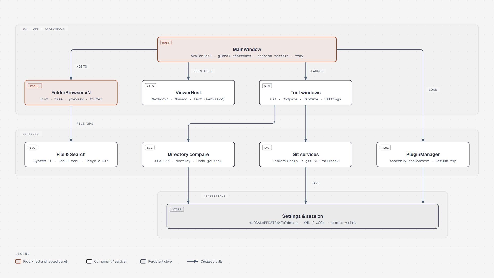

# 블록 편집기 3단계 기능 테스트 페이지

이 페이지는 **이슈 #77 (블록 편집기 3단계: 블록 종류·미디어)**에서 새롭게 추가된 기능들을 한눈에 확인하고 테스트할 수 있도록 작성된 종합 문서입니다.

[TOC]

---

## 1. 수식 블록 (Math) 및 인라인 수식

순수 C# WPF 수식 렌더러(`BlockMathRenderer`)를 통해 분수, 제곱근, 위/아래 첨자, 그리스 문자 및 기호가 렌더링됩니다. 블록을 클릭하면 원본 LaTeX 수식을 직접 편집할 수 있습니다.

$$
E = mc^2
$$

$$
x = \frac{-b \pm \sqrt{b^2 - 4ac}}{2a}
$$

$$
\sum_{i=1}^{n} i = \frac{n(n + 1)}{2}
$$

문단 텍스트 내에서도 피타고라스 정리 $a^2 + b^2 = c^2$ 와 오일러 공식 $e^{i\pi} + 1 = 0$ 같은 인라인 수식이 바로 표시됩니다.

---

## 2. 토글 제목 (Toggle Heading 1~3)

`<details><summary>` 형식으로 Markdown과 호환되며, 사이드카 속성(`heading: 1~3`)에 따라 H1~H3 글꼴 크기/굵기와 접기·펴기 화살표가 함께 적용됩니다. 상단 [TOC] 목차에도 자동 수집됩니다.

<details open>
<summary>토글 제목 1: 프로젝트 주요 목표</summary>

토글 제목 1 내부의 상세 내용입니다. 목록과 문단을 자유롭게 중첩할 수 있습니다.
- Windows 환경에 최적화된 고성능 파일 관리자
- 순수 Markdown 및 사이드카 기반의 메타데이터 분리 저장

</details>

<details open>
<summary>토글 제목 2: 핵심 아키텍처 원칙</summary>

토글 제목 2 내부의 설명입니다.
1. 대용량 문서 가상화 렌더링
2. IME 잠금 없는 편집 최적화

</details>

<details open>
<summary>토글 제목 3: 세부 구현 내역</summary>

토글 제목 3 수준의 하위 설명입니다.

</details>

---

## 3. 콜아웃 블록 및 이모지 아이콘

아이콘을 클릭하면 팝업이 열려 콜아웃 종류(`TIP`, `NOTE`, `WARNING` 등) 변경 및 사용자 지정 이모지 아이콘(`Attributes["icon"]`)을 선택할 수 있습니다.

> [!NOTE]
> 일반적인 안내 사항입니다. 기본 아이콘 또는 지정한 아이콘으로 표시됩니다.

> [!TIP]
> 팁 콜아웃입니다. 블록 메뉴에서 배경색이나 글자색을 추가로 지정할 수 있습니다.

> [!WARNING]
> 주의가 필요한 항목에 사용하는 경고 콜아웃입니다.

---

## 4. 파일 첨부 블록 (File)

Markdown에는 `[📎 이름](경로)` 형식으로 기록되며, 편집기 화면에서는 파일 크기(`size`), '열기' 버튼, '탐색기' 버튼이 있는 카드로 표시됩니다.

[📎 Folderss 솔루션 파일](../Folderss.sln)

[📎 아키텍처 명세서](architecture.md)

---

## 5. 북마크 블록 (Bookmark)

Markdown에는 `[🔖 제목](URL)` 형식으로 기록되며, 웹 주소 카드 형태로 렌더링됩니다. 카드에서 '미리보기 불러오기'를 누르면 웹페이지의 제목과 설명을 가져옵니다.

[🔖 Folderss GitHub 저장소](https://github.com/morluto/folderss)

---

## 6. 이미지 블록 및 미디어 기능

로컬 이미지는 화면 크기에 맞춰 백그라운드 디코딩됩니다. 이미지 우측 끝 핸들을 끌어 너비를 조절하거나 툴바/메뉴에서 좌·중·우 정렬, 원본 크기 보기, 탐색기 열기를 테스트할 수 있습니다.



원격 이미지(http/https)는 문서 열기 시 자동으로 외부 요청이 나가지 않도록 기본 차단되며, '이번만 불러오기' 버튼을 통해 수동 로드할 수 있습니다.


---

## 7. 기본 블록 점검 (표·할 일·코드)

기존 블록과의 연동 및 정규화 왕복을 점검합니다.

- [x] 수식 블록 및 인라인 수식 검증
- [x] 목차 자동 생성 및 클릭 이동 검증
- [x] 파일 첨부 및 북마크 카드 검증
- [ ] 이미지 크기 조절 핸들 드래그 테스트

| 구분 | 지원 형식 | 비고 |
| :--- | :--- | :--- |
| 수식 | `$$` 블록, `$` 인라인 | 순수 C# WPF |
| 목차 | `[TOC]`, `<!-- toc -->` | 제목 자동 링크 |
| 파일 | `[📎 이름](경로)` | 열기/탐색기 버튼 |
| 북마크 | `[🔖 제목](URL)` | 메타데이터 비동기 로드 |

```csharp
// Folderss BlockEditor BlockKind 확장
public enum BlockKind
{
    Paragraph,
    Heading1, Heading2, Heading3,
    Bulleted, Numbered, Todo, Toggle,
    Quote, Callout, Code, Math, Toc,
    Divider, TableRow, Raw, Image,
    File, Bookmark
}
```
